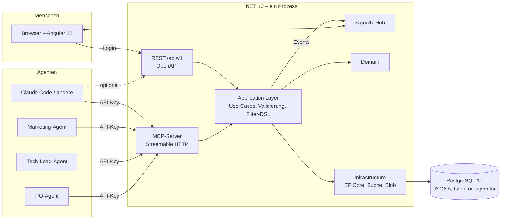
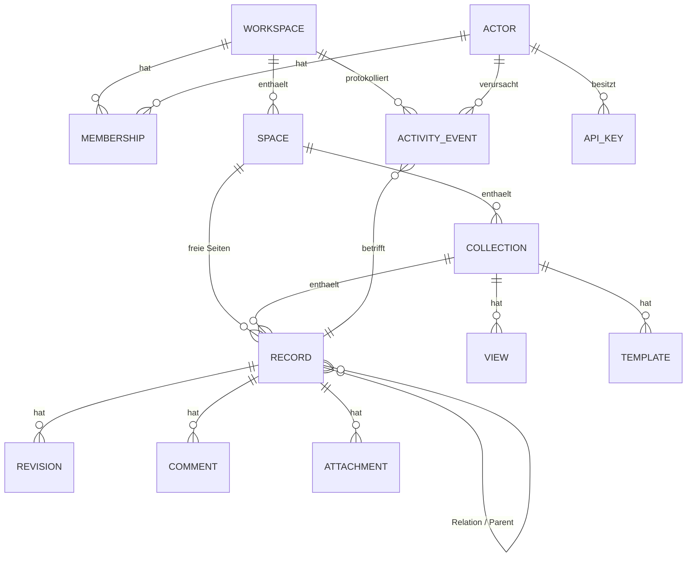

# agcowork – Architektur

> Technischer Entwurf zu [01-PLANUNG.md](01-PLANUNG.md). Stand: 2026-11-07.

## 1. Gesamtbild



MCP, REST und SignalR sind **Adapter**. Die gesamte Fachlogik liegt im Application Layer
und wird von allen drei identisch genutzt.

Jede Anfrage läuft im Kontext **genau eines Workspaces**, der aus der URL kommt
(`/w/{workspaceSlug}/…`). Eine Tenancy-Middleware löst den Slug auf, prüft die
Mitgliedschaft des Actors und stellt den Tenant-Kontext für alle Schichten bereit
(siehe §2a). Nur wenige Instanz-Endpunkte (Login, Workspace-Liste, Admin) liegen außerhalb.

## 2. Domänenmodell



### Entitäten

| Entität | Zweck | Wichtige Felder |
|---|---|---|
| **Workspace** | Mandant; beliebig viele pro Installation | `Slug` (URL, eindeutig), `Name`, `Settings`, `CreatedBy`, `ArchivedAt?` |
| **Membership** | Zugehörigkeit eines Actors zu einem Workspace | `WorkspaceId`, `ActorId`, `Role` (owner / admin / editor / viewer), `Scopes`, `SpaceRestrictions?` |
| **Space** | Bereich/Projekt/Team (z. B. „Projekt Alpha“, „Marketing“) | `Name`, `Description`, `Icon`, `SortOrder` |
| **Collection** | Typisierte Sammlung (Notion-„Database“) | `Name`, `Description` (Pflicht, für Agenten!), `Schema: PropertyDefinition[]` (JSONB-Hülle `{version, properties}`), `SchemaVersion` (Concurrency-Token), `TitlePropertyKey` (`title`), `ArchivedAt?` |
| **PropertyDefinition** | Feld im Schema (Teil der Collection, JSONB) | `Key`, `Name`, `Type`, `Description`, `Required`, `Options` (für select), `TargetCollectionId` (für relation), `Default` |
| **Record** | Datensatz / Seite | `Title`, `Properties: JSONB`, `Body: Markdown`, `CollectionId?`, `SpaceId`, `ParentRecordId?`, `RevisionNo`, `CreatedBy`, `UpdatedBy`, `Archived` |
| **View** | Präsentation einer Collection | `Name`, `Type` (table, board, gallery, list, document, raw), `Filter: JSON`, `Sorts`, `GroupByProperty`, `VisibleProperties`, `CardCoverProperty`, `IsDefault` |
| **Template** | Vorlage für neue Records | `CollectionId`, `Name`, `Description`, `PropertiesPreset`, `BodyMarkdown`, `IsDefault` (genau eine je Collection) |
| **Actor** | Agent oder Mensch, **global pro Installation** | `Kind` (Agent/Human), `Name`, `Role` (frei, z. B. „Tech-Lead“), `Email?`, `InstanceScopes` (`instance:admin`, `workspaces:create`), `IsActive` |
| **ApiKey** | Zugang eines Agenten | `ActorId`, `Prefix` (sichtbar), `Hash` (SHA-256), `WorkspaceId?` (optionale Einschränkung), `Scopes`, `ExpiresAt?`, `LastUsedAt`, `RevokedAt?` |
| **Revision** | Vollständiger Snapshot eines Records je Änderung | `RecordId`, `No`, `Properties`, `Body`, `ActorId`, `At`, `Reason?` |
| **ActivityEvent** | Append-only Log, pro Workspace | `WorkspaceId`, `Type` (record.created, record.updated, schema.changed, member.added …), `ActorId`, `Target`, `Diff: JSON`, `At` |
| **Comment** | Diskussion am Record | `RecordId`, `ActorId`, `BodyMarkdown`, `ParentCommentId?`, `Resolved` |
| **Attachment** (Phase 3) | Datei am Record | `RecordId`, `FileName`, `ContentType`, `Size`, `StorageKey` |

### Schema-Regeln (aus AP-006)

- Keys `^[a-z][a-z0-9_]{0,62}\z`, unveränderlich; reserviert: `id`, `collection`, `space`, `revision`, `body`; `title` ist immer vorhanden und vom Typ text.
- Erlaubte Typänderungen: text ↔ markdown, select → multi_select; Relation-Ziel unveränderlich, `multiple` nur false → true. **Destruktive Änderungen** (Feld entfernen, Option-Werte entfernen, `precision` senken, markdown → text) nur mit `confirmRemoval: true`; Entfernen + Neuanlegen desselben Keys im selben Request ist verboten.
- Erweiterungspunkte: `ICollectionCreatedHook` (Standard-Views) und `ISchemaChangedHook` (Templates, Record-Werte, Views bereinigen) laufen vor `SaveChanges` in derselben Unit of Work. Workspace-Vorlagen müssen Collections über `CreateCollection` anlegen, damit die Hooks laufen.
- Scopes: Lesen `read`; Space anlegen/ändern und Collection anlegen `write`; Schema, Collection-Metadaten, Archivieren, Vorlagen pflegen `schema`.
- relation, actor und berechnete Typen haben keinen Default; Status-Optionen brauchen eine Gruppe; Option-Farben aus fester Palette.
- Zusammengesetzte Fremdschlüssel über `workspace_id` (Collection → Space, Template → Collection), damit die DB Verweise über Workspace-Grenzen ablehnt.

### Property-Typen

`text`, `markdown`, `number`, `checkbox`, `select`, `multi_select`, `status`
(select mit Gruppen *todo / in_progress / done*), `date`, `datetime`, `url`, `email`,
`relation` (zu Collection, 1:n oder n:m), `actor` (Agent/Mensch), `json` (frei, für
Agenten-Payloads), `created_at`/`updated_at`/`created_by` (berechnet).

### Standard-Vorlage „Software-Projekt“

Jeder neue Workspace wird aus einer Vorlage erzeugt (`templateId`, Standard `software-projekt`,
Alternative `empty`). Die Vorlage ist in Phase 1 im Code definiert und legt an:

| Space | Sammlungen | Standard-Views |
|---|---|---|
| Produkt | Aufgaben, Analysen | Aufgaben: Board nach `status`, Tabelle; Analysen: Tabelle, Galerie |
| Technik | Entscheidungen, Komponenten | Entscheidungen: Tabelle nach `date` absteigend; Komponenten: Tabelle |
| Notizen | – (freie Seiten) | – |

Dazu je Sammlung eine Record-Vorlage (z. B. ADR-Gliederung für Entscheidungen) und
Beschreibungen, die für Agenten geschrieben sind. Der Workspace-Anleger wird Owner;
weitere Mitglieder werden explizit hinzugefügt. In Phase 3 kann jeder Workspace als Vorlage
markiert und seine Struktur ohne Records geklont werden.

### Sammlungen der Standard-Vorlage

**Entscheidungen** (ADR-artig)
`status` (vorgeschlagen / akzeptiert / verworfen / ersetzt), `decided_by` (actor),
`date`, `affects` (relation → Komponenten), `supersedes` (relation → Entscheidungen);
Body-Vorlage: *Kontext · Optionen · Entscheidung · Konsequenzen*.

**Aufgaben**
`status`, `owner` (actor), `priority` (select), `sprint` (select), `related_decision` (relation),
`due` (date), `estimate` (number).

**Analysen**
`kind` (Markt / Technik / Wettbewerb / Nutzer), `author` (actor), `sources` (markdown),
`confidence` (select), `summary` (text); Body: die Analyse selbst.

**Komponenten** (Systemteile, auf die Entscheidungen zeigen)
`kind`, `owner`, `repo_url`, `status`.

## 2a. Mandantentrennung (Tenancy)

**Grundregel:** Jede workspace-gebundene Tabelle (Space, Collection, Record, View, Template,
Revision, ActivityEvent, Comment, Attachment, Membership) trägt eine `WorkspaceId`.
Alle Indizes beginnen mit `WorkspaceId`.

**Ablauf einer Anfrage**

1. Routing extrahiert `{workspaceSlug}` aus `/w/{slug}/…` (REST, MCP und SignalR gleich).
2. Authentifizierung liefert den Actor (API-Key → Agent, Cookie → Mensch).
3. `TenantResolutionMiddleware` (nach `UseAuthorization`, nur für Endpunkte mit
   `TenantEndpointMetadata`; Middleware statt Endpoint-Filter, weil Minimal APIs die Handler-Services
   vor Filtern binden) lädt den Workspace, prüft die Membership des Actors und ggf. die
   Workspace-Einschränkung des Keys und setzt `ITenantContext { WorkspaceId, Slug, IsArchived,
   Membership, EffectiveScopes }` (einmal pro Scope). Kein Treffer → 404 (nicht 403, um die
   Existenz fremder Workspaces nicht zu verraten). Archiviert + schreibendes Verb → 409.
4. Der `DbContext` wendet einen **benannten Global Query Filter** (`tenant`)
   `e.WorkspaceId == tenant.WorkspaceId` per Konvention auf alle `ITenantEntity` an; ohne
   Tenant-Kontext greift `Guid.Empty`, es kommt also nichts zurück. `IgnoreQueryFilters` nur in
   begründeten, kommentierten Stellen (`ResolveTenant`, `ListMyWorkspaces`, Instanz-Admin).
   Der `TenantSaveChangesInterceptor` (fest in `AgcoworkDbContextOptions.Configure`) setzt
   `WorkspaceId` bei `Added` und verweigert fremde `WorkspaceId`; einzige Ausnahme sind
   Tenant-Entitäten, deren Workspace im selben `SaveChanges` neu entsteht (Workspace-Anlage,
   Vorlagen). `ExecuteUpdate`/`ExecuteDelete` umgehen den Interceptor, nicht den Filter.
5. Pro Transaktion `SET LOCAL app.workspace_id = …`; PostgreSQL **Row-Level-Security**
   verwirft alles andere (Phase 2, zweites Netz unabhängig von EF).
6. SignalR-Verbindungen treten der Gruppe `ws:{WorkspaceId}` bei; Events gehen nur dorthin.

**Weitere Regeln**

- Relationen zwischen Records werden beim Schreiben auf gleichen Workspace geprüft.
- Rollen → Scopes: viewer = read; editor = read, write; admin = read, write, schema, admin; owner =
  alles plus Owner-Übertragung und Archivieren. Effektive Scopes = Membership-Scopes ∩ Key-Scopes
  (leere Key-Scopes = uneingeschränkt). `instance:admin` impliziert `workspaces:create`.
- Owner-Invariante (mindestens ein Owner) wird unter `LockWorkspaceAsync` (`SELECT … FOR UPDATE`)
  geprüft, damit zwei gleichzeitige Herabstufungen nicht beide durchkommen.
- Indizes auf Tenant-Tabellen beginnen mit `workspace_id`; einzige Ausnahme ist der FK-Index
  `ix_memberships_actor_id` für „meine Workspaces“ (Modelltest prüft alle anderen).
- Use-Cases prüfen `RequireWritable` (409 bei archiviert) vor `RequireScope`. Die Middleware setzt nur
  `IsArchived`; ob ein Aufruf schreibt, weiß allein der Use-Case (POST kann lesen: Query, MCP).
- Ein Key mit Workspace- oder Scope-Einschränkung trägt **keine Instanz-Scopes**; sonst könnte er sich
  über `POST /actors/{self}/keys` einen uneingeschränkten Key erzeugen.
- Eigene Mitgliedschaft darf nur eingeschränkt, nie erweitert werden (409 `self_escalation`).
- Der Interceptor schützt auch die Workspace-Wurzel: Modified/Deleted auf einen anderen Workspace als
  den Tenant wirft. `ExecuteUpdate`/`ExecuteDelete` nie mit `IgnoreQueryFilters` oder `SetProperty(WorkspaceId, …)`.
- Volltext- und semantische Suche filtern immer auf `WorkspaceId` (Teil des Index).
- Caches sind per `WorkspaceId` geschlüsselt.
- Instanz-Ebene (außerhalb des Tenant-Kontexts): Login, `GET /workspaces` (eigene
  Mitgliedschaften), Workspace-Anlage (Actor braucht `workspaces:create`; der Anleger wird
  Owner), Actor- und Key-Verwaltung (`instance:admin`).
- Ein API-Key authentifiziert den Actor instanzweit; die Tenancy-Middleware prüft pro
  Anfrage die Mitgliedschaft im adressierten Workspace. Ein Key mit `WorkspaceId`-Einschränkung
  wird in jedem anderen Workspace abgelehnt.
- **Isolationstests** in der CI: `TenancyFixture` (Workspaces `alpha`/`beta`, je ein Agent mit Key,
  ein Nicht-Mitglied, ein auf `alpha` eingeschränkter Key). Jeder neue Endpunkt wird mit einer Zeile
  `AssertIsolatedAsync(method, relPath, body, homeStatus)` abgesichert, fremde IDs mit `AssertNotFoundAsync`.

## 3. Views: Datenmodell ≠ Präsentation

Ein View beschreibt, *wie* eine Collection gezeigt wird. Dieselbe Collection „Aufgaben“
kann als Tabelle (alle Felder), Board (gruppiert nach `status`), Karten (Titel + Owner + Prio)
und Liste erscheinen. Views sind Daten, werden per API/MCP angelegt und von der UI gerendert.

| View-Typ | Darstellung | Typische Parameter |
|---|---|---|
| `table` | Spalten = Properties, virtuelles Scrolling, Inline-Edit | sichtbare Spalten, Breiten, Sort, Filter |
| `board` | Spalten = Werte eines select/status, Karten per Drag&Drop | `groupBy`, Kartenfelder |
| `gallery` | Karten im Raster | Cover-Property, Kartenfelder |
| `list` | kompakte Zeilen, gut für Mobile | Sekundärfelder |
| `document` | ein Record als Seite: Titel, Properties oben, Markdown-Body | – |
| `raw` | JSON des Records / Markdown-Quelltext, read-only oder editierbar | – |
| `timeline` / `calendar` (Phase 3) | nach Datumsfeld | `dateProperty` |

Jede Collection bekommt automatisch `table` + `raw`. Jeder Record ist immer als `document`
und `raw` erreichbar, unabhängig von Views.

### Filter-DSL (überall identisch)

```json
{
  "and": [
    { "prop": "status", "op": "in", "value": ["todo", "in_progress"] },
    { "prop": "owner", "op": "eq", "value": "actor:tech-lead" },
    { "or": [
      { "prop": "due", "op": "lt", "value": "2026-12-01" },
      { "prop": "priority", "op": "eq", "value": "high" }
    ]}
  ]
}
```

Operatoren: `eq, neq, in, nin, contains, starts_with, gt, gte, lt, lte, is_empty, is_not_empty`.
Sortierung: `[{ "prop": "due", "dir": "asc" }]`. Paginierung per Cursor.
Übersetzung nach SQL über JSONB-Operatoren mit GIN-Index auf `properties`.

## 4. Agent-Schnittstelle

### 4.1 Grundsätze

- **Orientierung zuerst:** Ein Agent kann mit einem Aufruf den gesamten Workspace
  überblicken (Spaces, Collections mit Beschreibungen). Beschreibungen sind Pflicht
  und für Agenten geschrieben („Hier stehen alle Architekturentscheidungen. Lege eine
  neue an, bevor du …“).
- **Schema maschinenlesbar:** `collection_describe` liefert das Schema zusätzlich als
  JSON Schema, inkl. enum-Werten, Pflichtfeldern und Beispielen.
- **Fehler sind Hinweise:** Validierungsfehler kommen strukturiert
  (`{ "field": "status", "error": "not_in_options", "allowed": [...] }`), damit sich der
  Agent selbst korrigieren kann.
- **Idempotenz & Nebenläufigkeit:** `Idempotency-Key` bei Create, `expectedRevision` bei Update.
- **Actor überall:** Der API-Key bestimmt den Actor. Der Agent gibt sich nicht selbst aus.
- **Workspace implizit:** Der MCP-Endpunkt ist pro Workspace (`/w/{slug}/mcp`). Die Tools
  brauchen deshalb keinen Workspace-Parameter, und ein Agent kann nicht versehentlich im
  falschen Workspace schreiben. Ein Agent mit mehreren Workspaces konfiguriert mehrere
  MCP-Server-Einträge (oder fragt `GET /api/v1/workspaces`, wofür er Zugriff hat).
- **Wenige, mächtige Tools** statt vieler kleiner (LLMs wählen bei ~15 Tools zuverlässiger als bei 50).

### 4.2 MCP-Tools (Phase 1)

| Tool | Zweck |
|---|---|
| `workspace_overview()` | Spaces, Collections, Beschreibungen, Record-Zahlen – Einstieg für jeden Agenten |
| `collection_describe(collectionId)` | Schema, JSON Schema, Vorlagen, Beispiel-Records, vorhandene Views |
| `collection_create(spaceId, name, description, schema)` | Neue Sammlung anlegen |
| `collection_update_schema(collectionId, changes)` | Felder hinzufügen/ändern (additiv bevorzugt) |
| `records_query(collectionId, filter?, sort?, fields?, limit?, cursor?)` | Abfrage mit Filter-DSL |
| `record_get(recordId, includeBody?, includeHistory?, includeComments?)` | Einzelner Datensatz |
| `record_create(collectionId | spaceId, title, properties?, body?, templateId?)` | Anlegen |
| `record_update(recordId, properties?, body?, expectedRevision?, reason?)` | Ändern (Properties als Patch, Body ersetzen) |
| `record_append(recordId, markdown, section?)` | Markdown anhängen, z. B. Log-Einträge, ohne den Body zu kennen |
| `record_archive(recordId)` | Soft-Delete |
| `search(query, spaceId?, collectionId?, mode: fulltext | semantic)` | Suche über Titel, Properties, Body |
| `comment_add(recordId, markdown, parentCommentId?)` | Kommentieren |
| `history_get(recordId, limit?)` | Revisionen + Activity |
| `view_create(collectionId, type, name, filter?, sorts?, groupBy?, visibleProperties?)` | Ansicht für Menschen anlegen |
| `activity_recent(spaceId?, since?, actorId?)` | „Was ist seit gestern passiert?“ |

Instanz-Ebene (Endpunkt `/mcp`, ohne Workspace; nur für Agenten mit Instanz-Rechten sinnvoll):

| Tool | Zweck |
|---|---|
| `workspaces_list()` | Workspaces, in denen der Actor Mitglied ist, mit Rolle |
| `workspace_create(slug, name, description, templateId?)` | Neuen Workspace anlegen (braucht `workspaces:create`); `templateId` Standard `software-projekt`, alternativ `empty`; Anleger wird Owner |
| `templates_list()` | Verfügbare Workspace-Vorlagen mit Beschreibung |
| `workspace_add_member(workspaceId, actorId, role, scopes?)` | Mitglied hinzufügen (Owner/Admin des Workspaces) |

**MCP-Resources:** `agcowork://record/{id}` (Markdown-Rendering mit Properties-Frontmatter),
`agcowork://collection/{id}/schema`, `agcowork://space/{id}/overview`.

**MCP-Prompts (Phase 3):** `write_decision`, `daily_summary`, `review_open_tasks`.

Transport: Streamable HTTP unter `/w/{workspaceSlug}/mcp`, stateless, Auth per Bearer-Key.
Für Clients, die nur stdio können, ein kleiner Wrapper (`agcowork-mcp-stdio`, .NET-Tool),
der nach HTTP proxyt und den Workspace als Argument bekommt.

Beispiel-Konfiguration für Claude Code:

```json
{
  "mcpServers": {
    "agcowork-projekt-alpha": {
      "type": "http",
      "url": "https://agcowork.local/w/projekt-alpha/mcp",
      "headers": { "Authorization": "Bearer agck_…" }
    }
  }
}
```

### 4.3 REST `/api/v1`

Spiegelt die Tools 1:1 in Ressourcen-Stil. Alles Fachliche liegt unter dem Workspace-Präfix:

```
Instanz-Ebene
GET    /api/v1/me                       GET    /api/v1/workspaces           (eigene Mitgliedschaften)
POST   /api/v1/workspaces               (Instanz-Admin)
GET    /api/v1/actors   POST /api/v1/actors   POST /api/v1/actors/{id}/keys   DELETE /api/v1/keys/{id}

Workspace-Ebene  (Präfix /api/v1/w/{workspaceSlug})
GET    /spaces   POST /spaces   GET|PATCH /spaces/{id}   POST /spaces/{id}/archive
GET    /collections?spaceId=   POST /collections   GET|PATCH /collections/{id}   POST /collections/{id}/archive
GET    /collections/{id}/schema         PATCH  /collections/{id}/schema   ({add, update, remove, confirmRemoval, expectedSchemaVersion})
GET    /collections/{id}/describe       (Schema + JSON Schema + Vorlagen + Beispiel + Statistik)
GET|POST /collections/{id}/templates    PATCH|DELETE /collections/{id}/templates/{templateId}
POST   /collections/{id}/query          (Filter-DSL im Body)
GET    /records/{id}                    POST   /records
PATCH  /records/{id}                    POST   /records/{id}/append
GET    /records/{id}/history            POST   /records/{id}/comments
GET    /search?q=…                      GET    /activity?since=…
GET    /views/{id}                      POST   /views
GET    /members   POST /members   PATCH /members/{actorId}   DELETE /members/{actorId}
```

OpenAPI 3.1 wird generiert, Scalar als Doku-UI. Die Angular-App nutzt denselben API-Client
(generiert aus OpenAPI).

### 4.4 Record-Repräsentation für Agenten

Agenten bekommen Records wahlweise als JSON oder als **Markdown mit Frontmatter**:

```markdown
---
id: rec_01HZX…
collection: Entscheidungen
title: PostgreSQL statt MongoDB
status: akzeptiert
decided_by: actor:tech-lead
date: 2026-11-05
revision: 3
---
## Kontext
…
## Entscheidung
…
```

Das ist das Format, das LLMs am besten lesen und schreiben.

## 5. Backend-Struktur (.NET 10)

```
agcowork.sln
├─ src/
│  ├─ Agcowork.Domain/           Entitäten, Value Objects, Domain-Events, Property-Typsystem
│  ├─ Agcowork.Application/      Use-Cases (Vertical Slices), Validierung, Filter-DSL → Spezifikation,
│  │                             Schema→JSON-Schema, Markdown-Frontmatter, Berechtigungen, Tenant-Kontext
│  ├─ Agcowork.Infrastructure/   EF Core + Npgsql, Migrationen, Volltext, (pgvector), Blob-Storage,
│  │                             API-Key-Hashing, Outbox → SignalR
│  ├─ Agcowork.Api/              Host: Minimal APIs, MCP-Endpoint, SignalR, Auth, OpenAPI, Health
│  ├─ Agcowork.Mcp.Stdio/        Optionaler stdio→HTTP-Proxy als dotnet tool
│  ├─ Agcowork.AppHost/          .NET Aspire: Postgres, Api, Angular-Dev-Server
│  └─ Agcowork.Web/              Angular 22
├─ tests/
│  ├─ Agcowork.Domain.Tests/
│  ├─ Agcowork.Application.Tests/
│  ├─ Agcowork.Api.Tests/        Integration mit Testcontainers (REST + MCP end-to-end)
│  └─ Agcowork.Web.E2E/          Playwright
└─ docs/
```

### Module (Vertical Slices in Application)

`Tenancy` (Workspaces, Memberships, Tenant-Kontext), `Schema` (Collections, Properties,
Templates), `Records`, `Views`, `Query` (Filter-DSL), `Activity` (Revisions, Events),
`Comments`, `Identity` (Actors, Keys, Scopes, Instanz-Admin), `Search`, `Realtime`.

### Use-Case- und Fehler-Muster (aus AP-004, verbindlich für alle Backend-Pakete)

- **Use-Case** = eine `sealed class` pro Operation mit Primärkonstruktor, implementiert
  `IUseCase<TRequest, TResponse>` (liefert `Result<T>`) oder `IUseCase<TRequest>` (liefert `Result`).
  Der Request-Record steht in derselben Datei. Reihenfolge im Code: **autorisieren → validieren →
  Zustand prüfen → ändern und speichern → mappen**. `AddApplication()` registriert alle Use-Cases
  per Assembly-Scan (scoped); Endpunkte injizieren den konkreten Typ.
- **Autorisierung im Use-Case**, nicht nur am Endpunkt:
  `if (currentActor.RequireInstanceScope(InstanceScope.Admin) is { } denied) return denied;`
  (ab AP-005 analog `RequireScope("write")` gegen die effektiven Workspace-Scopes).
- **Result/Fehler** (`Application/Common/Results`): eigener Typ, implizite Konvertierungen für Wert
  und Fehler. Fehlertypen `ValidationError(FieldError[])`, `NotFoundError`, `ForbiddenError`,
  `UnauthorizedError` (Grund nur ins Log), `ConflictError(Code, Message, Field?)`. Feldfehler über
  `FieldErrors` (`Required`, `MaxLength`, `OneOf`, `AllOneOf`); Listenelemente heißen `field[i]`.
- **Datenzugriff** über `IAgcoworkDbContext` (DbSets), keine Repositories.
- **Unique-Verletzungen** werden zentral übersetzt: `SaveChangesOrConflictAsync(ct, UniqueConflict("ix_…", new ConflictError("…_taken", …)))`; der Context wirft bei SqlState 23505 eine `UniqueConstraintViolationException(ConstraintName)`. Check-then-insert bleibt als schneller Pfad, der Konfliktpfad ist die Wahrheit. Nach einem Konflikt den Fehler zurückgeben, nicht erneut speichern.
- **Listen** einheitlich `Result.Success<IReadOnlyList<T>>(…)` (implizite Konvertierung greift bei Interface-T nicht).
- **Authorization-Requirements** mit DI-Abhängigkeiten (z. B. Membership-Lookup) brauchen einen separaten `AuthorizationHandler<T>`; Requirement+Handler in einer Klasse nur ohne Abhängigkeiten.
- **Endpunkte** unter `Api/Endpoints/<Modul>/…`, Gruppe `/api/v1` mit `RequireAuthorization` als
  Standard. Handler-Signatur `Task<Results<Ok<T>, ProblemHttpResult>>`, Rückgabe
  `result.IsSuccess ? TypedResults.Ok(result.Value) : result.Error.ToProblem()`. Mit Routenparametern
  gibt es einen eigenen Body-Record, sonst ist der Request-Record der Body.
- **Fehlerformat** (RFC 9457, festgenagelt in `ProblemDetailsFormatTests`): `type`, `title`,
  `status`, `code` (maschinenlesbar, immer), `detail` nur bei 400/403/409, `errors[]` mit `field`,
  `code`, `message`, optional `allowed`, dazu `traceId`. 401 ohne Details, 404 ohne Existenzhinweis.
- **Tests**: Domain-Unit; Application-Tests gegen Testcontainers-Postgres (`PostgresFixture`, Schema
  einmal in Template-DB, pro Test eigene DB per `CREATE DATABASE … TEMPLATE`, Basisklasse `DatabaseTest`);
  Api-Integration mit Testcontainers über `AgcoworkApiFactory` (`CreateAdminClientAsync`, `CreateAgentClientAsync(scopes)`,
  `CreateAgentAsync` → `TestAgent`).

### Wichtige technische Punkte

- **Properties-Validierung** zentral im Application Layer anhand des Collection-Schemas;
  gleicher Code für REST, MCP, UI.
- **Revisionen**: vollständiger Snapshot (einfach, robust), Diff wird für das ActivityEvent berechnet.
- **Outbox-Pattern**: Domain-Events werden transaktional gespeichert und danach an SignalR
  (und später Webhooks) ausgeliefert.
- **Suche**: generierte `tsvector`-Spalte aus Titel + Body + Text-Properties, GIN-Index.
  Semantik später via pgvector + Embedding-Provider hinter einem Interface.
- **Auth-Pipeline**: Bearer-Key → Actor als ClaimsPrincipal; Cookie-Login für Menschen;
  danach Tenancy-Middleware → Membership → Scopes. Gleiche Authorization-Policies für alle
  Adapter (`CanRead(space)`, `CanWrite(space)`, `WorkspaceAdmin`, `InstanceAdmin`).
- **Keine Retry-Execution-Strategy** (`DisableRetry = true` bei `EnrichNpgsqlDbContext`). Use-Cases dürfen `BeginTransactionAsync` direkt verwenden, z. B. für Revision + Record in einer Transaktion. Transiente Verbindungsfehler fängt der AppHost (`WaitFor`) bzw. später der Betrieb ab; sollte Retry doch nötig werden, gilt verbindlich `CreateExecutionStrategy().ExecuteAsync(...)` um jede Transaktion.
- **Reihenfolge nie über die Id**: UUIDv7 ist innerhalb derselben Millisekunde nicht monoton. Wer Reihenfolge braucht (Revisionen, Activity), sortiert nach `CreatedAt` plus laufender Nummer.
- **Persistenz-Muster** (aus AP-001, für alle weiteren Pakete): Provider-Konfiguration an genau einer Stelle (`AgcoworkDbContextOptions.Configure`), gemeinsam für Laufzeit und Design-Time; Connection-String lazy auflösen, damit Tests den Container ohne Service-Override einhängen; Unique-Tests prüfen SqlState und Constraint-Namen.
- **Tenancy in EF Core**: Interface `ITenantEntity { WorkspaceId }`, ein Global Query Filter
  per Konvention für alle Implementierungen, `SaveChanges`-Interceptor setzt `WorkspaceId`
  und verweigert Änderungen an fremden Entitäten.
- **Observability**: OpenTelemetry (Traces, Logs, Metrics) über Aspire-Dashboard; jeder
  MCP-Tool-Aufruf ist ein Span mit Actor-Tag.

## 6. Frontend (Angular 22)

### Prinzipien
Zoneless, Standalone Components, Signals überall, `httpResource`/`resource()` für Daten,
Signal Forms für Property-Editoren, Lazy Routes pro Feature.

### Routen
```
/login
/workspaces                                        Workspace-Wechsler (eigene Mitgliedschaften)
/admin/workspaces                                  Instanz-Admin: Workspaces anlegen, archivieren
/admin/actors                                      Instanz-Admin: Actors, API-Keys

/w/:workspaceSlug                                  Workspace-Start: Spaces, zuletzt geändert
/w/:workspaceSlug/spaces/:spaceId                  Übersicht, Collections, freie Seiten
/w/:workspaceSlug/collections/:collectionId/views/:viewId     Table | Board | Gallery | List
/w/:workspaceSlug/records/:recordId                Document-View (Editor)
/w/:workspaceSlug/records/:recordId/raw            Raw-View (JSON + Markdown, Monaco)
/w/:workspaceSlug/records/:recordId/history        Revisionen, Diff
/w/:workspaceSlug/search?q=
/w/:workspaceSlug/activity                         Workspace-weiter Feed
/w/:workspaceSlug/settings/members                 Mitglieder (Menschen + Agenten), Rollen, Scopes
/w/:workspaceSlug/settings/collections/:id/schema  Schema-Editor
```

Der Workspace-Slug steckt in der URL, damit Links eindeutig und teilbar sind. Ein
`WorkspaceContext`-Service (Signal) hält den aktiven Workspace; der API-Client setzt das
Präfix automatisch. Beim Wechsel werden alle Daten-Resources neu geladen und die
SignalR-Gruppe gewechselt.

### Bausteine
- **Table**: eigene Komponente auf CDK Virtual Scroll, Inline-Editing, Spalten-Resize/Reorder, Sort/Filter-Leiste (Filter-DSL-Builder).
- **Board**: CDK DragDrop zwischen Spalten, Statuswechsel → `record_update`.
- **Gallery/List**: Karten-Komponenten mit konfigurierbaren Feldern.
- **Document**: Markdown-WYSIWYG (Milkdown bevorzugt: ProseMirror-basiert, Markdown-nativ), Properties-Panel oben, Kommentar-Seitenleiste.
- **Raw**: Monaco, umschaltbar JSON ↔ Markdown+Frontmatter, optional editierbar mit Validierung.
- **Property-Editoren**: eine Komponente pro Typ, von Table, Document und Filter-Builder gemeinsam genutzt.
- **Live**: SignalR-Client aktualisiert Signals; Konflikte (fremde Revision) werden angezeigt statt überschrieben.
- **Theming**: Tailwind mit Design-Tokens, Hell/Dunkel.

## 7. Sicherheit

- API-Keys: `agck_<prefix>_<secret>`; nur SHA-256-Hash gespeichert, Prefix zur Identifikation, Rotation und Widerruf in der UI.
- Scopes: `read`, `write`, `schema`, `admin`, pro Membership vergeben, optional eingeschränkt auf Spaces.
- Mandantentrennung: Tenant-Kontext aus URL, Global Query Filter, Row-Level-Security, Isolationstests in der CI (siehe §2a). Fremde Workspaces antworten mit 404.
- Alle Schreibzugriffe im ActivityEvent mit Actor; keine anonymen Änderungen.
- Rate-Limiting pro Key, Request-Größenlimits (Body-Markdown z. B. 2 MB).
- HTTPS verpflichtend außer `localhost`; CORS nur für die eigene UI.
- Markdown-Rendering sanitisiert (kein rohes HTML aus Agenten-Inhalten).
- `/health`, `/health/ready` und `/openapi/v1.json` sind in allen Umgebungen ohne Auth erreichbar (Health ohne Details). `/health/ready` öffnet eine DB-Verbindung. Bei öffentlicher Erreichbarkeit: Reverse-Proxy oder Rate-Limit davor, OpenAPI ggf. nur mit Auth.
- Slug-Validierung mit `\z` statt `$` (`$` matcht in .NET vor einem abschließenden Zeilenumbruch).

## 8. Betrieb

- **Lokal**: `dotnet run --project src/Agcowork.AppHost` startet alles (Aspire). Alternativ `docker compose up`.
- **Daten**: ein Postgres-Volume; Backup = `pg_dump`; zusätzlich täglicher Markdown-Export pro Workspace (git-freundlich, ein Ordner je Workspace).
- **Workspace-Lebenszyklus**: Anlegen durch Instanz-Admin (optional aus Vorlage), Archivieren (read-only), Löschen nur nach Export.
- **Migrationen**: EF Core, beim Start angewendet (Single-Instance).
- **Konfiguration**: `appsettings` + Umgebungsvariablen; Secrets über User-Secrets / Env.
