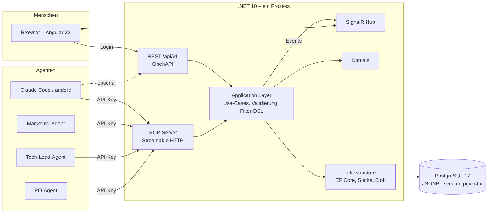
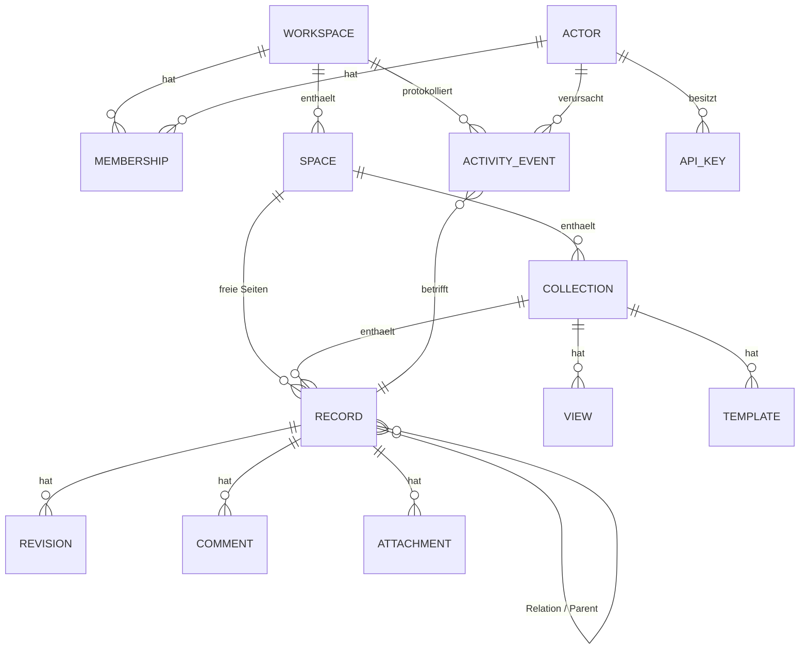

# agcowork – Architektur

> Technischer Entwurf zu [01-PLANUNG.md](01-PLANUNG.md). Stand: 2026-11-07.

## 1. Gesamtbild



MCP, REST und SignalR sind **Adapter**. Die gesamte Fachlogik liegt im Application Layer
und wird von allen drei identisch genutzt.

Jede Anfrage läuft im Kontext **genau eines Workspaces**, der aus der URL kommt
(`/w/{workspaceSlug}/…`). Eine Tenancy-Middleware löst den Slug auf, prüft die
Mitgliedschaft des Actors und stellt den Tenant-Kontext für alle Schichten bereit
(siehe §2a). Nur wenige Instanz-Endpunkte (Login, Workspace-Liste, Admin) liegen außerhalb.

## 2. Domänenmodell



### Entitäten

| Entität | Zweck | Wichtige Felder |
|---|---|---|
| **Workspace** | Mandant; beliebig viele pro Installation | `Slug` (URL, eindeutig), `Name`, `Settings`, `CreatedBy`, `ArchivedAt?` |
| **Membership** | Zugehörigkeit eines Actors zu einem Workspace | `WorkspaceId`, `ActorId`, `Role` (owner / admin / editor / viewer), `Scopes`, `SpaceRestrictions?` |
| **Space** | Bereich/Projekt/Team (z. B. „Projekt Alpha“, „Marketing“) | `Name`, `Description`, `Icon`, `SortOrder` |
| **Collection** | Typisierte Sammlung (Notion-„Database“) | `Name`, `Description` (Pflicht, für Agenten!), `Schema: PropertyDefinition[]` (JSONB-Hülle `{version, properties}`), `SchemaVersion` (Concurrency-Token), `TitlePropertyKey` (`title`), `ArchivedAt?` |
| **PropertyDefinition** | Feld im Schema (Teil der Collection, JSONB) | `Key`, `Name`, `Type`, `Description`, `Required`, `Options` (für select), `TargetCollectionId` (für relation), `Default` |
| **Record** | Datensatz / Seite | `Title`, `Properties: JSONB`, `Body: Markdown`, `CollectionId?`, `SpaceId`, `ParentRecordId?`, `RevisionNo`, `CreatedBy`, `UpdatedBy`, `Archived` |
| **View** | Präsentation einer Collection | `Name`, `Type` (table, board, gallery, list, document, raw), `Filter: JSON`, `Sorts`, `GroupByProperty`, `VisibleProperties`, `CardCoverProperty`, `IsDefault` |
| **Template** | Vorlage für neue Records | `CollectionId`, `Name`, `Description`, `PropertiesPreset`, `BodyMarkdown`, `IsDefault` (genau eine je Collection) |
| **Actor** | Agent oder Mensch, **global pro Installation** | `Kind` (Agent/Human), `Name`, `Role` (frei, z. B. „Tech-Lead“), `Email?`, `InstanceScopes` (`instance:admin`, `workspaces:create`), `IsActive` |
| **ApiKey** | Zugang eines Agenten | `ActorId`, `Prefix` (sichtbar), `Hash` (SHA-256), `WorkspaceId?` (optionale Einschränkung), `Scopes`, `ExpiresAt?`, `LastUsedAt`, `RevokedAt?` |
| **Revision** | Vollständiger Snapshot eines Records je Änderung | `RecordId`, `No`, `Properties`, `Body`, `ActorId`, `At`, `Reason?` |
| **ActivityEvent** | Append-only Log, pro Workspace | `WorkspaceId`, `Type` (record.created, record.updated, schema.changed, member.added …), `ActorId`, `Target`, `Diff: JSON`, `At` |
| **Comment** | Diskussion am Record (AP-029) | `RecordId`, `AuthorId`, `BodyMarkdown`, `ParentCommentId?` (eine Ebene), `ResolvedAt?`/`ResolvedBy?` (nur Wurzel), `EditedAt?`, `DeletedAt?` (weich) |
| **Mention** | Erwähnung eines Actors in einem Kommentar (AP-029) | `CommentId`, `RecordId`, `MentionedActorId`, `ByActorId`, `CreatedAt`, `ReadAt?` |
| **Attachment** (Phase 3) | Datei am Record | `RecordId`, `FileName`, `ContentType`, `Size`, `StorageKey` |

### Kommentare und Erwähnungen (Entscheidungen 2026-11-08, AP-029)

- **Threads mit einer Ebene:** Ein Kommentar ist Wurzel oder Antwort auf eine Wurzel (`ParentCommentId` zeigt nie auf eine Antwort). Nur Wurzeln lassen sich erledigen (`resolve`/`reopen`); erledigte Threads bleiben lesbar.
- **Bearbeiten und Löschen:** Nur der Autor bearbeitet. Löschen darf der Autor oder ein Actor mit `admin`; gelöscht wird weich (`DeletedAt`, Body geleert), damit Antworten ihren Thread behalten. Kein Revisionsverlauf für Kommentare; `EditedAt` zeigt Bearbeitung an.
- **Rechte:** Lesen `read`, Kommentieren `write`. Ein eigener `comment`-Scope (Kommentieren ohne Schreibrecht) ist möglich, aber nicht Teil von AP-029.
- **Erwähnungen nur in Kommentaren**, nicht im Record-Body (Body-Erwähnungen bräuchten Abgleich über Revisionen; später möglich).
- **Syntax (kanonisch, Markdown, E2):** `[@Anzeigename](actor:<uuid>)`. Der Server erkennt Erwähnungen ausschließlich an `actor:<uuid>`-Links; der Anzeigename ist frei und wird nicht geprüft. Erwähnt werden können nur Mitglieder des Workspaces (sonst 400 `not_member` am Feld `markdown` mit der ID). Es gibt bewusst nur diesen einen Weg (kein separater `mentions`-Parameter), damit Text und Erwähnungen nie auseinanderlaufen; `comment_add` beschreibt die Syntax, `workspace_overview`/Members liefern die IDs.
- **Posteingang:** Jede Erwähnung erzeugt eine `Mention`-Zeile pro erwähntem Actor (nicht für sich selbst). `GET /mentions` und MCP `mentions_list` liefern die eigenen Erwähnungen (neueste zuerst, Filter `unreadOnly`), `mentions_mark_read` setzt `ReadAt`. Beim Bearbeiten werden neue Erwähnungen angelegt, entfernte gelöscht; beim Löschen des Kommentars alle seine Erwähnungen.
- **Umsetzung (AP-029):** Erledigen/Wiederöffnen laufen über `UpdateComment` (REST zusätzlich `/resolve`, `/reopen`, `PATCH` mit `resolved`); MCP löscht über `comment_update(deleted: true)`. Alle Kommentar-Schreibzugriffe sind bei archiviertem Record, Collection oder Space 409 – auch Löschen (ein Admin stellt den Record dafür vorher wieder her). Antwort auf eine gelöschte Wurzel → 409 `comment_deleted`. `actor:<keine uuid>` → 400 `invalid_value`. Beim Bearbeiten werden nur neu hinzugekommene Erwähnungen gegen die Mitgliedschaft geprüft. `MarkMentionsRead` braucht nur `read` und geht auch in archivierten Workspaces (persönlicher Zustand). Idempotenz für `comment_add` über dieselbe Tabelle `idempotency_keys` (Spalte `comment_id`); ein Schlüssel für eine andere Anfrageart oder einen anderen Record → 409 `idempotency_key_reused`. `ListComments` liefert höchstens die 500 neuesten Threads (`omittedThreads`) und je Thread höchstens die 100 neuesten Antworten (`omittedReplies`); `includeComments` gilt in REST und MCP auch für `format=markdown` (gemeinsamer Renderer `CommentText`). Feldfehler bei `not_member`/`invalid_value` sind auf 20 gekappt. Erwähnungen folgen CommonMark: nicht in Code-Spans, Codeblöcken (Fence oder 4 Leerzeichen) und HTML-Kommentaren; Linktext darf innerhalb eines Absatzes umbrechen (Regeln im XML-Kommentar von `CommentMarkdown`). Freie Namen werden in MCP-Textausgaben gequotet bzw. einzeilig ausgegeben. Sperr-Reihenfolge: Collection (share) → Record `FOR SHARE` → Kommentar `FOR UPDATE`; Antworten sperren ihre Wurzel. `workspace_overview` enthält einen Members-Abschnitt mit Actor-IDs (Quelle für Erwähnungen).
- **Activity:** `comment.created|updated|deleted|resolved|reopened` mit `targetType = comment`, `targetId = CommentId`, Diff enthält `recordId`, `parentCommentId` und `mentionedActorIds`. Damit liefern Realtime (AP-024) und `activity_recent` Kommentare und Erwähnungen ohne neuen Kanal.

### Schema-Regeln (aus AP-006)

- Keys `^[a-z][a-z0-9_]{0,62}\z`, unveränderlich; reserviert: `id`, `collection`, `space`, `revision`, `body`; `title` ist immer vorhanden und vom Typ text.
- Erlaubte Typänderungen: text ↔ markdown, select → multi_select; Relation-Ziel unveränderlich, `multiple` nur false → true. **Destruktive Änderungen** (Feld entfernen, Option-Werte entfernen, `precision` senken, markdown → text) nur mit `confirmRemoval: true`; Entfernen + Neuanlegen desselben Keys im selben Request ist verboten.
- Erweiterungspunkte: `ICollectionCreatedHook` (Standard-Views) und `ISchemaChangedHook` (Templates, Record-Werte, Views bereinigen) laufen vor `SaveChanges` in derselben Unit of Work; `UpdateSchema` öffnet dafür eine Transaktion, damit auch `ExecuteUpdate`-Bereinigungen (Record-Werte) atomar mit der Schemaänderung sind. Workspace-Vorlagen müssen Collections über `CreateCollection` anlegen, damit die Hooks laufen.
- Scopes: Lesen `read`; Space anlegen/ändern und Collection anlegen `write`; Schema, Collection-Metadaten, Archivieren, Vorlagen pflegen `schema`.
- relation, actor und berechnete Typen haben keinen Default; Status-Optionen brauchen eine Gruppe; Option-Farben aus fester Palette.
- Zusammengesetzte Fremdschlüssel über `workspace_id` (Collection → Space, Template → Collection), damit die DB Verweise über Workspace-Grenzen ablehnt.

### Property-Typen

`text`, `markdown`, `number`, `checkbox`, `select`, `multi_select`, `status`
(select mit Gruppen *todo / in_progress / done*), `date`, `datetime`, `url`, `email`,
`relation` (zu Collection, 1:n oder n:m), `actor` (Agent/Mensch), `json` (frei, für
Agenten-Payloads), `created_at`/`updated_at`/`created_by` (berechnet).

### Standard-Vorlage „Software-Projekt“

Jeder neue Workspace wird aus einer Vorlage erzeugt (`templateId`, Standard `software-projekt`,
Alternative `empty`). Die Vorlage ist in Phase 1 im Code definiert und legt an:

| Space | Sammlungen | Standard-Views |
|---|---|---|
| Produkt | Aufgaben, Analysen | Aufgaben: Board nach `status`, Tabelle; Analysen: Tabelle, Galerie |
| Technik | Entscheidungen, Komponenten | Entscheidungen: Tabelle nach `date` absteigend; Komponenten: Tabelle |
| Notizen | – (freie Seiten) | – |

Dazu je Sammlung eine Record-Vorlage (z. B. ADR-Gliederung für Entscheidungen) und
Beschreibungen, die für Agenten geschrieben sind. Der Workspace-Anleger wird Owner;
weitere Mitglieder werden explizit hinzugefügt. In Phase 3 kann jeder Workspace als Vorlage
markiert und seine Struktur ohne Records geklont werden.

### Sammlungen der Standard-Vorlage

**Entscheidungen** (ADR-artig)
`status` (vorgeschlagen / akzeptiert / verworfen / ersetzt), `decided_by` (actor),
`date`, `affects` (relation → Komponenten), `supersedes` (relation → Entscheidungen);
Body-Vorlage: *Kontext · Optionen · Entscheidung · Konsequenzen*.

**Aufgaben**
`status`, `owner` (actor), `priority` (select), `sprint` (select), `related_decision` (relation),
`due` (date), `estimate` (number).

**Analysen**
`kind` (Markt / Technik / Wettbewerb / Nutzer), `author` (actor), `sources` (markdown),
`confidence` (select), `summary` (text); Body: die Analyse selbst.

**Komponenten** (Systemteile, auf die Entscheidungen zeigen)
`kind`, `owner`, `repo_url`, `status`.

## 2a. Mandantentrennung (Tenancy)

**Grundregel:** Jede workspace-gebundene Tabelle (Space, Collection, Record, View, Template,
Revision, ActivityEvent, Comment, Attachment, Membership) trägt eine `WorkspaceId`.
Alle Indizes beginnen mit `WorkspaceId`.

**Ablauf einer Anfrage**

1. Routing extrahiert `{workspaceSlug}` aus `/w/{slug}/…` (REST, MCP und SignalR gleich).
2. Authentifizierung liefert den Actor (API-Key → Agent, Cookie → Mensch).
3. `TenantResolutionMiddleware` (nach `UseAuthorization`, nur für Endpunkte mit
   `TenantEndpointMetadata`; Middleware statt Endpoint-Filter, weil Minimal APIs die Handler-Services
   vor Filtern binden) lädt den Workspace, prüft die Membership des Actors und ggf. die
   Workspace-Einschränkung des Keys und setzt `ITenantContext { WorkspaceId, Slug, IsArchived,
   Membership, EffectiveScopes }` (einmal pro Scope). Kein Treffer → 404 (nicht 403, um die
   Existenz fremder Workspaces nicht zu verraten). Archiviert + schreibendes Verb → 409.
4. Der `DbContext` wendet einen **benannten Global Query Filter** (`tenant`)
   `e.WorkspaceId == tenant.WorkspaceId` per Konvention auf alle `ITenantEntity` an; ohne
   Tenant-Kontext greift `Guid.Empty`, es kommt also nichts zurück. `IgnoreQueryFilters` nur in
   begründeten, kommentierten Stellen (`ResolveTenant`, `ListMyWorkspaces`, Instanz-Admin).
   Der `TenantSaveChangesInterceptor` (fest in `AgcoworkDbContextOptions.Configure`) setzt
   `WorkspaceId` bei `Added` und verweigert fremde `WorkspaceId`; einzige Ausnahme sind
   Tenant-Entitäten, deren Workspace im selben `SaveChanges` neu entsteht (Workspace-Anlage,
   Vorlagen). `ExecuteUpdate`/`ExecuteDelete` umgehen den Interceptor, nicht den Filter.
5. Pro Transaktion `SET LOCAL app.workspace_id = …`; PostgreSQL **Row-Level-Security**
   verwirft alles andere (Phase 2, zweites Netz unabhängig von EF).
6. SignalR-Hub `/w/{slug}/hub` (Cookie oder Bearer, AP-024). Negotiate und Transport laufen durch `TenantResolutionMiddleware` und `RealtimeConnectMiddleware` (`read` Pflicht, sonst 403); unbekannt oder fremd → 404. Die Verbindung tritt der Gruppe `ws:{WorkspaceId}` bei, Events gehen nur dorthin. Vor jeder Zustellung prüft der Dispatcher jede Verbindung des Workspaces erneut (Mitgliedschaft mit `read`, Actor aktiv, Key gültig und nicht auf einen anderen Workspace eingeschränkt, Passwort-Stamp der Session); entzogene Verbindungen werden getrennt.

**Weitere Regeln**

- Relationen zwischen Records werden beim Schreiben auf gleichen Workspace geprüft.
- Rollen → Scopes: viewer = read; editor = read, write; admin = read, write, schema, admin; owner =
  alles plus Owner-Übertragung und Archivieren. Effektive Scopes = Membership-Scopes ∩ Key-Scopes
  (leere Key-Scopes = uneingeschränkt). `instance:admin` impliziert `workspaces:create`.
- Owner-Invariante (mindestens ein Owner) wird unter `LockWorkspaceAsync` (`SELECT … FOR UPDATE`)
  geprüft, damit zwei gleichzeitige Herabstufungen nicht beide durchkommen. Analog `LockRecordAsync`
  für Record-Schreibzugriffe (rohes SQL, parametrisiert, mit expliziter `workspace_id`-Bedingung).
- Indizes auf Tenant-Tabellen beginnen mit `workspace_id`; einzige Ausnahme ist der FK-Index
  `ix_memberships_actor_id` für „meine Workspaces“ (Modelltest prüft alle anderen).
- Use-Cases prüfen `RequireWritable` (409 bei archiviert) vor `RequireScope`. Die Middleware setzt nur
  `IsArchived`; ob ein Aufruf schreibt, weiß allein der Use-Case (POST kann lesen: Query, MCP).
- Ein Key mit Workspace- oder Scope-Einschränkung trägt **keine Instanz-Scopes**; sonst könnte er sich
  über `POST /actors/{self}/keys` einen uneingeschränkten Key erzeugen.
- Eigene Mitgliedschaft darf nur eingeschränkt, nie erweitert werden (409 `self_escalation`).
- Workspace-Vorlagen laufen nach Anlage des Workspaces im selben Scope mit den **vollen Owner-Scopes**
  (Key-Scopes werden dafür ignoriert): Die Vorlage ist fester Code, kein Nutzerinhalt. `CreateWorkspace`
  setzt den Tenant-Kontext; MCP `workspace_create` braucht dafür einen eigenen Scope.
- Der Interceptor schützt auch die Workspace-Wurzel: Modified/Deleted auf einen anderen Workspace als
  den Tenant wirft. `ExecuteUpdate`/`ExecuteDelete` nie mit `IgnoreQueryFilters` oder `SetProperty(WorkspaceId, …)`.
- Volltext- und semantische Suche filtern immer auf `WorkspaceId` (Teil des Index).
- Caches sind per `WorkspaceId` geschlüsselt.
- Instanz-Ebene (außerhalb des Tenant-Kontexts): Login, `GET /workspaces` (eigene
  Mitgliedschaften), Workspace-Anlage (Actor braucht `workspaces:create`; der Anleger wird
  Owner), Actor- und Key-Verwaltung (`instance:admin`).
- Ein API-Key authentifiziert den Actor instanzweit; die Tenancy-Middleware prüft pro
  Anfrage die Mitgliedschaft im adressierten Workspace. Ein Key mit `WorkspaceId`-Einschränkung
  wird in jedem anderen Workspace abgelehnt.
- **Isolationstests** in der CI: `TenancyFixture` (Workspaces `alpha`/`beta`, je ein Agent mit Key,
  ein Nicht-Mitglied, ein auf `alpha` eingeschränkter Key). Jeder neue Endpunkt wird mit einer Zeile
  `AssertIsolatedAsync(method, relPath, body, homeStatus)` abgesichert, fremde IDs mit `AssertNotFoundAsync`.

## 3. Views: Datenmodell ≠ Präsentation

Ein View beschreibt, *wie* eine Collection gezeigt wird. Dieselbe Collection „Aufgaben“
kann als Tabelle (alle Felder), Board (gruppiert nach `status`), Karten (Titel + Owner + Prio)
und Liste erscheinen. Views sind Daten, werden per API/MCP angelegt und von der UI gerendert.

| View-Typ | Darstellung | Typische Parameter |
|---|---|---|
| `table` | Spalten = Properties, virtuelles Scrolling, Inline-Edit | sichtbare Spalten, Breiten, Sort, Filter |
| `board` | Spalten = Werte eines select/status, Karten per Drag&Drop | `groupBy`, Kartenfelder |
| `gallery` | Karten im Raster | Cover-Property, Kartenfelder |
| `list` | kompakte Zeilen, gut für Mobile | Sekundärfelder |
| `document` | ein Record als Seite: Titel, Properties oben, Markdown-Body | – |
| `raw` | JSON des Records / Markdown-Quelltext, read-only oder editierbar | – |
| `timeline` / `calendar` (Phase 3) | nach Datumsfeld | `dateProperty` |

Jede Collection bekommt automatisch `table` + `raw`. Jeder Record ist immer als `document`
und `raw` erreichbar, unabhängig von Views.

### Filter-DSL (überall identisch)

```json
{
  "and": [
    { "prop": "status", "op": "in", "value": ["todo", "in_progress"] },
    { "prop": "owner", "op": "eq", "value": "actor:tech-lead" },
    { "or": [
      { "prop": "due", "op": "lt", "value": "2026-12-01" },
      { "prop": "priority", "op": "eq", "value": "high" }
    ]}
  ]
}
```

Knoten: `{ "and": [ … ] }`, `{ "or": [ … ] }`, `{ "not": { … } }` oder eine Bedingung `{ "prop", "op", "value" }`,
beliebig verschachtelt (max. 8 Ebenen, 100 Bedingungen); `{}` heißt „kein Filter“, unbekannte Schlüssel sind Fehler.
Operatoren: `eq, neq, in, nin, contains, starts_with, gt, gte, lt, lte, is_empty, is_not_empty`.
Sortierung: `[{ "prop": "due", "dir": "asc" }]`. Paginierung per Cursor.
Übersetzung nach SQL über JSONB-Operatoren mit GIN-Index auf `properties`.

**Typ-Matrix (verbindlich, aus AP-009; im Code `OperatorMatrix`):**

| Typ | Operatoren | Werte |
|---|---|---|
| `text`, `markdown`, `url`, `email`, Pseudo-Feld `title` | eq, neq, contains, starts_with, in, nin, is_empty, is_not_empty | String; `contains`/`starts_with` case-insensitiv, `eq` exakt |
| `number` | eq, neq, gt, gte, lt, lte, in, nin, is_empty, is_not_empty | JSON-Zahl |
| `checkbox` | eq, neq, is_empty | `true`/`false` |
| `select`, `status` | eq, neq, in, nin, is_empty, is_not_empty | Option-Wert (muss existieren) |
| `multi_select` | contains (ein Wert), in (Schnittmenge nicht leer), nin, is_empty, is_not_empty | Option-Wert(e) |
| `date` | eq, neq, gt, gte, lt, lte, is_empty, is_not_empty | `YYYY-MM-DD` |
| `datetime`, `created_at`, `updated_at` | eq, neq, gt, gte, lt, lte, is_empty, is_not_empty | ISO 8601 mit Offset; reines Datum (= Tagesbeginn UTC) nur bei gt/gte/lt/lte |
| `relation` | contains (Record-Id), in, nin, is_empty, is_not_empty | Record-Id |
| `actor`, `created_by`, `updated_by` | eq, neq, in, nin, is_empty, is_not_empty | Actor-Id oder `actor:<id>` |
| `json` | – (weder filter- noch sortierbar) | – |

Regeln:
- `prop` ist ein Schema-Key oder ein Pseudo-Feld (`title`, `created_at`, `updated_at`, `created_by`, `updated_by`);
  ein Schema-Key gleichen Namens gewinnt. Berechnete Properties (Typen `created_at` usw. unter beliebigem Key) und
  Pseudo-Felder werden auf die Spalten abgebildet, nie auf `properties->>'key'`.
- „Leer“ (`is_empty`) heißt: Key fehlt oder `null`; bei Text-Typen auch `""`, bei `multi_select`/`relation` auch `[]`.
  `neq`/`nin` treffen auch Records ohne Wert; jede Bedingung ist NULL-frei, `not` ist das exakte Komplement.
- Fehler (400, `errors[]` mit Pfad wie `filter.and[1].op`): `unknown_property`, `unknown_operator`,
  `operator_not_applicable` (`allowed` = Operatoren des Typs), `invalid_value` (Meldung nennt den erwarteten Typ),
  `not_in_options` (Wert existiert im Schema nicht mehr, `allowed` = Optionen), `not_sortable`, `invalid_cursor`;
  unbekannte Schlüssel im Request-Body (z. B. `sort` statt `sorts`) → `unknown_property` mit den erlaubten Feldern.
  Strings mit NUL (`\u0000`) oder ungepaarten Surrogaten werden als `invalid_value` (im Cursor: `invalid_cursor`)
  abgelehnt, weil PostgreSQL sie nicht speichern kann.
- Sortierung typgerecht (number numerisch, date/datetime zeitlich, Text nach DB-Collation, select nach Wert, nicht nach
  Options-Reihenfolge); fehlende Werte (Key fehlt oder `null`) zuletzt in beiden Richtungen – `""` ist beim Sortieren
  ein normaler Wert und steht aufsteigend vorn; Tie-Breaker immer `(created_at, id)`.
  `multi_select`, `relation` und `json` sind nicht sortierbar.
- Cursor: opak (Base64url), enthält die Sortierwerte des letzten Records (wie die DB sie berechnet hat) plus
  `(created_at, id)` und ist an die Sortierung gebunden; Keyset-Paginierung, keine OFFSETs; `nextCursor` nur, wenn
  weitere Treffer existieren. Ungültig oder zu anderer Sortierung → 400 `invalid_cursor`.
- SQL: `eq`/`in` auf Text, select/status, checkbox, actor und `contains`/`in` auf multi_select/relation als
  `properties @> '{"key": …}'` (GIN `(workspace_id, properties jsonb_path_ops)`); Vergleiche über
  `jsonb_extract_path_text` mit Cast (numeric/date/timestamptz, abgesichert über `jsonb_typeof`); `contains`/`starts_with`
  als `ILIKE` mit maskierten Wildcards. Werte und Keys sind immer Parameter. Der Parser (`QueryParser`) ist die einzige
  Stelle, die die DSL versteht; REST, MCP und gespeicherte Views (`ViewDefinitionValidator`) nutzen ihn.
- Abfrage: `POST /collections/{id}/query` (`filter`, `sorts`, `fields` mit `body` auf Anfrage, `limit` 1..500,
  `cursor`, `includeArchived`, `includeCount` bis 10 000); `POST /views/{id}/query` führt Filter, Sorts und
  `visibleProperties` des Views aus, ein Zusatzfilter wird per `and` kombiniert (zusammen max. 150 Bedingungen).
  Gespeicherte Views, die die strengere Matrix verletzen (angelegt vor AP-009 nur strukturell geprüft), liefern dort
  400 auf `view.filter…` bzw. `view.sorts…`; sie werden mit `PATCH /views/{id}` korrigiert.
- Schemaänderungen bereinigen Views (`ViewSchemaHook`): entfernte Properties und Optionen verschwinden aus Filtern
  (`eq`/`neq`/`contains` auf eine entfernte Option → Bedingung weg, `in`/`nin` verlieren den Wert), Sortierungen auf
  nicht mehr sortierbare Properties (select → multi_select) fallen weg. Bereinigung unterhalb von `not` macht den Filter
  enger, nicht weiter.

## 4. Agent-Schnittstelle

### 4.1 Grundsätze

- **Orientierung zuerst:** Ein Agent kann mit einem Aufruf den gesamten Workspace
  überblicken (Spaces, Collections mit Beschreibungen). Beschreibungen sind Pflicht
  und für Agenten geschrieben („Hier stehen alle Architekturentscheidungen. Lege eine
  neue an, bevor du …“).
- **Schema maschinenlesbar:** `collection_describe` liefert das Schema zusätzlich als
  JSON Schema, inkl. enum-Werten, Pflichtfeldern und Beispielen.
- **Fehler sind Hinweise:** Validierungsfehler kommen strukturiert
  (`{ "field": "status", "error": "not_in_options", "allowed": [...] }`), damit sich der
  Agent selbst korrigieren kann.
- **Unlesbare Eingaben** (AP-028): NUL und ungepaarte Surrogate in Texten ergeben 400 `invalid_value` am Feld (zentral `StorableText`/`FieldErrors.Storable`), nie 500 oder stille Ersetzung. Binder-Fehler mit JSON-Pfad (falscher Typ, ungültiges Format, Surrogat in typisierten Feldern) liefern `validation_failed` mit Feld statt `bad_request` – auch in Production (`ThrowOnBadRequest = true`, ohne Error-Log); kaputtes JSON bleibt `bad_request`. MCP fängt unlesbare Tool-Argumente vor dem SDK ab und antwortet ebenso.
- **Idempotenz & Nebenläufigkeit:** `Idempotency-Key` bei Create, `expectedRevision` bei Update.
- **Actor überall:** Der API-Key bestimmt den Actor. Der Agent gibt sich nicht selbst aus.
- **Workspace implizit:** Der MCP-Endpunkt ist pro Workspace (`/w/{slug}/mcp`). Die Tools
  brauchen deshalb keinen Workspace-Parameter, und ein Agent kann nicht versehentlich im
  falschen Workspace schreiben. Ein Agent mit mehreren Workspaces konfiguriert mehrere
  MCP-Server-Einträge (oder fragt `GET /api/v1/workspaces`, wofür er Zugriff hat).
- **Wenige, mächtige Tools** statt vieler kleiner (LLMs wählen bei ~15 Tools zuverlässiger als bei 50).

### 4.2 MCP-Tools (Phase 1)

| Tool | Zweck |
|---|---|
| `workspace_overview()` | Spaces, Collections, Beschreibungen, Record-Zahlen – Einstieg für jeden Agenten |
| `collection_describe(collectionId)` | Schema, JSON Schema, Vorlagen, Beispielwerte, vorhandene Views (umgesetzt AP-011) |
| `collection_create(spaceId, name, description, schema)` | Neue Sammlung anlegen |
| `collection_update_schema(collectionId, changes)` | Felder hinzufügen/ändern (additiv bevorzugt) |
| `records_query(collectionId, filter?, sort?, fields?, limit?, cursor?)` | Abfrage mit Filter-DSL |
| `record_get(recordId, includeBody?, includeHistory?, includeComments?)` | Einzelner Datensatz |
| `record_create(collectionId | spaceId, title, properties?, body?, templateId?)` | Anlegen |
| `record_update(recordId, properties?, body?, expectedRevision?, reason?)` | Ändern (Properties als Patch, Body ersetzen) |
| `record_append(recordId, markdown, section?)` | Markdown anhängen, z. B. Log-Einträge, ohne den Body zu kennen |
| `record_archive(recordId)` | Soft-Delete |
| `search(query, spaceId?, collectionId?, includeArchived?, limit?, cursor?)` | Volltextsuche über Titel, Text-Properties, Optionen und Body-Präfix; Snippet mit Markern ⟦…⟧ (AP-026). Parameter `mode` (semantic) erst mit Phase 3 |
| `comment_add(recordId, markdown, parentCommentId?, idempotencyKey?)` | Kommentieren, Antworten, Erwähnen (AP-029) |
| `comments_list(recordId, includeResolved?)` / `comment_update(commentId, markdown?, resolved?, deleted?)` | Diskussion lesen, bearbeiten, erledigen (AP-029) |
| `mentions_list(unreadOnly?, limit?, cursor?)` / `mentions_mark_read(mentionIds? , all?)` | „Wo wurde ich gefragt?“ (AP-029) |
| `history_get(recordId, limit?)` | Revisionen (Activity je Record über `activity_recent`, Phase 2 filterbar nach Record) |
| `view_create(collectionId, type, name, filter?, sorts?, groupBy?, visibleProperties?)` | Ansicht für Menschen anlegen |
| `activity_recent(spaceId?, collectionId?, actorId?, targetId?, since?, types?, afterSeq?, limit?, cursor?)` | Rückblick („Was ist seit gestern passiert?“, absteigend) oder lückenloses Mitlesen mit `afterSeq`/`lastSeq` (AP-024) |

Instanz-Ebene (Endpunkt `/mcp`, ohne Workspace; nur für Agenten mit Instanz-Rechten sinnvoll):

| Tool | Zweck |
|---|---|
| `workspaces_list()` | Workspaces, in denen der Actor Mitglied ist, mit Rolle |
| `workspace_create(slug, name, description, templateId?)` | Neuen Workspace anlegen (braucht `workspaces:create`); `templateId` Standard `software-projekt`, alternativ `empty`; Anleger wird Owner |
| `templates_list()` | Verfügbare Workspace-Vorlagen mit Beschreibung |
| `workspace_add_member(workspaceId, actorId, role, scopes?)` | Mitglied hinzufügen (Owner/Admin des Workspaces) |

**MCP-Resources:** `agcowork://record/{id}` (Markdown-Rendering mit Properties-Frontmatter),
`agcowork://collection/{id}/schema`, `agcowork://space/{id}/overview`.

**MCP-Prompts (Phase 3):** `write_decision`, `daily_summary`, `review_open_tasks`.

Transport: Streamable HTTP unter `/w/{workspaceSlug}/mcp`, stateless, Auth per Bearer-Key.
Für Clients, die nur stdio können, ein kleiner Wrapper (`agcowork-mcp-stdio`, .NET-Tool),
der nach HTTP proxyt und den Workspace als Argument bekommt.

Beispiel-Konfiguration für Claude Code:

```json
{
  "mcpServers": {
    "agcowork-projekt-alpha": {
      "type": "http",
      "url": "https://agcowork.local/w/projekt-alpha/mcp",
      "headers": { "Authorization": "Bearer agck_…" }
    }
  }
}
```

### 4.3 REST `/api/v1`

Spiegelt die Tools 1:1 in Ressourcen-Stil. Alles Fachliche liegt unter dem Workspace-Präfix:

```
Instanz-Ebene
GET    /api/v1/me                       GET    /api/v1/workspaces           (eigene Mitgliedschaften)
POST   /api/v1/workspaces               (Instanz-Admin)
GET    /api/v1/actors   POST /api/v1/actors   POST /api/v1/actors/{id}/keys   DELETE /api/v1/keys/{id}
PATCH  /api/v1/me/password             PUT    /api/v1/actors/{id}/password   (Instanz-Admin, Reset)

Workspace-Ebene  (Präfix /api/v1/w/{workspaceSlug})
GET    /spaces   POST /spaces   GET|PATCH /spaces/{id}   POST /spaces/{id}/archive
GET    /collections?spaceId=   POST /collections   GET|PATCH /collections/{id}   POST /collections/{id}/archive
GET    /collections/{id}/schema         PATCH  /collections/{id}/schema   ({add, update, remove, confirmRemoval, expectedSchemaVersion})
GET    /collections/{id}/describe       (Schema + JSON Schema + Vorlagen + Beispiel + Statistik)
GET|POST /collections/{id}/templates    PATCH|DELETE /collections/{id}/templates/{templateId}
POST   /collections/{id}/query          (Filter-DSL im Body)
GET    /records/{id}                    POST   /records
PATCH  /records/{id}                    POST   /records/{id}/append
GET    /records/{id}/history            POST   /records/{id}/comments
GET    /records/{id}/comments   PATCH|DELETE /comments/{id}   POST /comments/{id}/resolve|reopen
GET    /mentions?unreadOnly=        POST   /mentions/read   ({ids?, all?})
GET    /search?q=&spaceId&collectionId&includeArchived&limit&cursor                      GET    /activity?since=…
GET    /views/{id}                      POST   /views   POST /views/{id}/query
GET    /members   POST /members   PATCH /members/{actorId}   DELETE /members/{actorId}
```

OpenAPI 3.1 wird generiert, Scalar als Doku-UI. Die Angular-App nutzt denselben API-Client
(generiert aus OpenAPI).

### 4.4 Record-Repräsentation für Agenten

Agenten bekommen Records wahlweise als JSON oder als **Markdown mit Frontmatter**:

```markdown
---
id: rec_01HZX…
collection: Entscheidungen
title: PostgreSQL statt MongoDB
status: akzeptiert
decided_by: actor:tech-lead
date: 2026-11-05
revision: 3
---
## Kontext
…
## Entscheidung
…
```

Das ist das Format, das LLMs am besten lesen und schreiben. Umgesetzt (AP-007): feste Felder `id`,
`collection`, `collection_id`, `space`, `space_id`, `title`, `parent_record_id?`, `archived_at?`,
`revision`, `created_at`, `updated_at`, `created_by`, `updated_by`; Properties als YAML-Skalare/Listen,
bei Namenskollision mit einem festen Feld als `properties.<key>`. `GET …/records/{id}?format=markdown`
liefert `text/markdown`. Rückweg (Frontmatter → Properties) gibt es nicht; Agenten schreiben per PATCH.

## 5. Backend-Struktur (.NET 10)

```
agcowork.slnx
├─ src/
│  ├─ backend/
│  │  ├─ Agcowork.Domain/           Entitäten, Value Objects, Property-Typsystem, Invarianten
│  │  ├─ Agcowork.Application/      Use-Cases (Vertical Slices), Validierung, Filter-DSL, JSON Schema,
│  │  │                             Markdown-Frontmatter, Tenant-Kontext, Hooks
│  │  ├─ Agcowork.Infrastructure/   EF Core + Npgsql, Migrationen, Tenant-Filter/-Interceptor, Query-Übersetzer
│  │  ├─ Agcowork.Api/              Host: Minimal APIs, MCP-Endpunkte, Auth, OpenAPI, Health
│  │  ├─ Agcowork.Mcp.Stdio/        stdio→HTTP-Proxy als dotnet tool
│  │  ├─ Agcowork.ServiceDefaults/  Aspire-Standard (OpenTelemetry, Health, Resilience)
│  │  └─ Agcowork.AppHost/          .NET Aspire: Postgres, Api, Angular-Dev-Server
│  └─ frontend/                     Angular 22 (package.json liegt direkt hier)
├─ tests/
│  ├─ Agcowork.Domain.Tests/
│  ├─ Agcowork.Application.Tests/   gegen Testcontainers-Postgres
│  └─ Agcowork.Api.Tests/           Integration mit Testcontainers (REST + MCP end-to-end)
└─ docs/
```

### Module (Vertical Slices in Application)

`Tenancy` (Workspaces, Memberships, Tenant-Kontext), `Schema` (Collections, Properties,
Templates), `Records`, `Views`, `Query` (Filter-DSL), `Activity` (Revisions, Events),
`Comments`, `Identity` (Actors, Keys, Scopes, Instanz-Admin), `Search`, `Realtime`.

### Use-Case- und Fehler-Muster (aus AP-004, verbindlich für alle Backend-Pakete)

- **Use-Case** = eine `sealed class` pro Operation mit Primärkonstruktor, implementiert
  `IUseCase<TRequest, TResponse>` (liefert `Result<T>`) oder `IUseCase<TRequest>` (liefert `Result`).
  Der Request-Record steht in derselben Datei. Reihenfolge im Code: **autorisieren → validieren →
  Zustand prüfen → ändern und speichern → mappen**. `AddApplication()` registriert alle Use-Cases
  per Assembly-Scan (scoped); Endpunkte injizieren den konkreten Typ.
- **Autorisierung im Use-Case**, nicht nur am Endpunkt:
  `if (currentActor.RequireInstanceScope(InstanceScope.Admin) is { } denied) return denied;`
  (ab AP-005 analog `RequireScope("write")` gegen die effektiven Workspace-Scopes).
- **Result/Fehler** (`Application/Common/Results`): eigener Typ, implizite Konvertierungen für Wert
  und Fehler. Fehlertypen `ValidationError(FieldError[])`, `NotFoundError`, `ForbiddenError`,
  `UnauthorizedError` (Grund nur ins Log), `ConflictError(Code, Message, Field?)`. Feldfehler über
  `FieldErrors` (`Required`, `MaxLength`, `OneOf`, `AllOneOf`); Listenelemente heißen `field[i]`.
- **Datenzugriff** über `IAgcoworkDbContext` (DbSets), keine Repositories.
- **Unique-Verletzungen** werden zentral übersetzt: `SaveChangesOrConflictAsync(ct, UniqueConflict("ix_…", new ConflictError("…_taken", …)))`; der Context wirft bei SqlState 23505 eine `UniqueConstraintViolationException(ConstraintName)`. Check-then-insert bleibt als schneller Pfad, der Konfliktpfad ist die Wahrheit. Nach einem Konflikt den Fehler zurückgeben, nicht erneut speichern.
- **Listen** einheitlich `Result.Success<IReadOnlyList<T>>(…)` (implizite Konvertierung greift bei Interface-T nicht).
- **Authorization-Requirements** mit DI-Abhängigkeiten (z. B. Membership-Lookup) brauchen einen separaten `AuthorizationHandler<T>`; Requirement+Handler in einer Klasse nur ohne Abhängigkeiten.
- **Endpunkte** unter `Api/Endpoints/<Modul>/…`, Gruppe `/api/v1` mit `RequireAuthorization` als
  Standard. Handler-Signatur `Task<Results<Ok<T>, ProblemHttpResult>>`, Rückgabe
  `result.IsSuccess ? TypedResults.Ok(result.Value) : result.Error.ToProblem()`. Mit Routenparametern
  gibt es einen eigenen Body-Record, sonst ist der Request-Record der Body.
- **Fehlerformat** (RFC 9457, festgenagelt in `ProblemDetailsFormatTests`): `type`, `title`,
  `status`, `code` (maschinenlesbar, immer), `detail` nur bei 400/403/409, `errors[]` mit `field`,
  `code`, `message`, optional `allowed`, dazu `traceId`. 401 ohne Details, 404 ohne Existenzhinweis.
  409-Konflikte dürfen `ConflictError.Details` tragen, die als Extensions erscheinen (z. B.
  `revision_mismatch` mit `currentRevision` und `changedKeys`).
- **Sperr-Reihenfolge**: `UpdateSchema` sperrt die Collection `FOR UPDATE`; Record-Schreiber sperren die
  Collection `FOR SHARE` und dann den Record `FOR UPDATE` (immer Collection → Record). So kann eine
  Schemaänderung keine parallel geschriebenen Werte überschreiben und niemand gegen ein veraltetes
  Schema validieren.
- **Bekannte Ausnahme**: Die Bereinigung von Record-Werten bei destruktiven Schemaänderungen erzeugt
  keine Revision; der Stand vor der Bereinigung steht nur in der letzten Revision, das Event
  `collection.schema_changed` trägt `affectedRecords`.
- **Nebenläufigkeit bei Records**: Row-Lock (`LockRecordAsync`) + `revision_no` als Concurrency-Token.
  Ohne `expectedRevision` gewinnt der letzte Schreiber; parallele `append`s laufen lückenlos durch;
  `expectedRevision` veraltet → 409 `revision_mismatch`. Idempotenz über `Idempotency-Key` (24 h).
- **Tests**: Domain-Unit; Application-Tests gegen Testcontainers-Postgres (`PostgresFixture`, Schema
  einmal in Template-DB, pro Test eigene DB per `CREATE DATABASE … TEMPLATE`, Basisklasse `DatabaseTest`);
  Api-Integration mit Testcontainers über `AgcoworkApiFactory` (`CreateAdminClientAsync`, `CreateAgentClientAsync(scopes)`,
  `CreateAgentAsync` → `TestAgent`).

### Wichtige technische Punkte

- **Properties-Validierung** zentral im Application Layer anhand des Collection-Schemas;
  gleicher Code für REST, MCP, UI.
- **Revisionen**: vollständiger Snapshot (einfach, robust), Diff wird für das ActivityEvent berechnet.
- **Outbox-Pattern** (AP-024): `activity_events` ist die Outbox; das Ereignis wird in derselben Transaktion wie die Änderung geschrieben. Wer vorwärts liest (Dispatcher, `afterSeq`), liest nur stabile Ereignisse (`xact_id < pg_snapshot_xmin(pg_current_snapshot())`) und sortiert nach (`xact_id`, `seq`), nicht nach `seq` allein: Eine Transaktion mit früher xid kann eine höhere Seq vor einer niedrigeren committen. `afterSeq` ist die Seq eines Ereignisses, der Server schlägt seine Position nach; `lastSeq` ist immer weiterzugeben (kann kleiner sein als vorher gesehene Seqs). Der Dispatcher (`BackgroundService`) pollt alle 250 ms instanzweit über `ix_activity_events_xact_id_seq` (Ausnahme von der workspace_id-Indexregel), hält den Cursor im Speicher (Start beim Kopf, kein Nachliefern) und stellt höchstens einmal zu. Eine lange schreibende Transaktion im PostgreSQL-Cluster verzögert Zustellung und Vorwärtslesen (Betrieb: `idle_in_transaction_session_timeout`). Single-Instance: Mehrere API-Instanzen brauchen einen SignalR-Backplane. Zustellung pro Verbindung über einen begrenzten Postausgang (256) mit Sende-Timeout (`Agcowork:Realtime:SendTimeout`, Standard 5 s): Ein Client, der nicht liest, wird getrennt und hält niemanden auf. Nur `lastSeq` ist ein sicherer Cursor, nicht die `seq` einzelner Ereignisse aus dem Rückblick. Schlägt die Zustellung an einen Workspace fehl (AP-028), werden dessen Verbindungen getrennt („lückenlos oder getrennt“); Clients holen per `afterSeq` nach, aufeinanderfolgende Fehler werden pro Workspace gezählt und geloggt.
- **Suche** (AP-026): `records.search_vector tsvector`, gepflegt per Trigger; die Spalte ist nicht im EF-Modell (sonst würde sie bei jedem Record mitgelesen). Konfiguration `simple`, gewichtet: A Titel; B text-, markdown-, url-, email-Werte sowie Label und Value gewählter select-/status-/multi_select-Optionen (Typ aus dem Collection-Schema, daher Trigger statt generierter Spalte), höchstens 25.000 Zeichen; C die ersten 75.000 Zeichen des Bodys. Im gemessenen Worst Case (4-Byte-Buchstaben in Bindestrich-Komposita, ≈ 8 Byte/Zeichen) bleibt das unter dem 1-MB-Limit von tsvector; bei `program_limit_exceeded` indexiert die Funktion ein Zehntel der Präfixe, zuletzt nur den Titel; Schreiben und Migration scheitern nie. Schemaänderungen an indexierten Properties indexieren synchron in derselben Transaktion nur Records mit Wert unter einem geänderten Key (Grenze: ein Statement, Command-Timeout; Hintergrund-Reindex ist Folgepaket). GIN-Index `(workspace_id, search_vector)`. Abfragen über `RecordSearchFunctions` (Translator) auf den tenant-gefilterten Records; Records in archivierten Collections oder Spaces gelten als archiviert. Eingabe per `websearch_to_tsquery`, Präfix auf dem letzten Wort ab 2 Zeichen; Rang `float4(ts_rank_cd(…, 32) + 1 bei Titeltreffer)`, Keyset über (Rang, Id). Snippets per `ts_headline` nur für die ausgelieferte Seite und nur aus den ersten 20.000 Zeichen von Property-Text und Body; Marker U+27E6/U+27E7, das Snippet ist reiner Text und kann Markup aus dem Inhalt enthalten (Clients rendern als Text). Semantik später via pgvector hinter einem Interface.
- **Auth-Pipeline**: Bearer-Key → Actor als ClaimsPrincipal; Cookie-Login für Menschen;
  danach Tenancy-Middleware → Membership → Scopes. Gleiche Authorization-Policies für alle
  Adapter (`CanRead(space)`, `CanWrite(space)`, `WorkspaceAdmin`, `InstanceAdmin`).
- **Keine Retry-Execution-Strategy** (`DisableRetry = true` bei `EnrichNpgsqlDbContext`). Use-Cases dürfen `BeginTransactionAsync` direkt verwenden, z. B. für Revision + Record in einer Transaktion. Transiente Verbindungsfehler fängt der AppHost (`WaitFor`) bzw. später der Betrieb ab; sollte Retry doch nötig werden, gilt verbindlich `CreateExecutionStrategy().ExecuteAsync(...)` um jede Transaktion.
- **Reihenfolge nie über die Id**: UUIDv7 ist innerhalb derselben Millisekunde nicht monoton. Wer Reihenfolge braucht (Revisionen, Activity), sortiert nach `CreatedAt` plus laufender Nummer. Vorwärtslesende auf Activity sortieren nach (`xact_id`, `seq`).
- **Persistenz-Muster** (aus AP-001, für alle weiteren Pakete): Provider-Konfiguration an genau einer Stelle (`AgcoworkDbContextOptions.Configure`), gemeinsam für Laufzeit und Design-Time; Connection-String lazy auflösen, damit Tests den Container ohne Service-Override einhängen; Unique-Tests prüfen SqlState und Constraint-Namen.
- **Tenancy in EF Core**: Interface `ITenantEntity { WorkspaceId }`, ein Global Query Filter
  per Konvention für alle Implementierungen, `SaveChanges`-Interceptor setzt `WorkspaceId`
  und verweigert Änderungen an fremden Entitäten.
- **Observability**: OpenTelemetry (Traces, Logs, Metrics) über Aspire-Dashboard; jeder
  MCP-Tool-Aufruf ist ein Span mit Actor-Tag.

## 6. Frontend (Angular 22)

### Prinzipien
Zoneless, Standalone Components, Signals überall, `httpResource`/`resource()` für Daten,
Signal Forms für Property-Editoren, Lazy Routes pro Feature.

### Routen
```
/login
/workspaces                                        Workspace-Wechsler (eigene Mitgliedschaften)
/admin/workspaces                                  Instanz-Admin: Workspaces anlegen, archivieren
/admin/actors                                      Instanz-Admin: Actors, API-Keys

/w/:workspaceSlug                                  Workspace-Start: Spaces, zuletzt geändert
/w/:workspaceSlug/spaces/:spaceId                  Übersicht, Collections, freie Seiten
/w/:workspaceSlug/collections/:collectionId/views/:viewId     Table | Board | Gallery | List
/w/:workspaceSlug/records/:recordId                Document-View (Editor)
/w/:workspaceSlug/records/:recordId/raw            Raw-View (JSON + Markdown, Monaco)
/w/:workspaceSlug/records/:recordId/history        Revisionen, Diff
/w/:workspaceSlug/search?q=
/w/:workspaceSlug/activity                         Workspace-weiter Feed
/w/:workspaceSlug/settings/members                 Mitglieder (Menschen + Agenten), Rollen, Scopes
/w/:workspaceSlug/settings/collections/:id/schema  Schema-Editor
```

Der Workspace-Slug steckt in der URL, damit Links eindeutig und teilbar sind. Ein
`WorkspaceContext`-Service (Signal) hält den aktiven Workspace; der API-Client setzt das
Präfix automatisch. Beim Wechsel werden alle Daten-Resources neu geladen und die
SignalR-Gruppe gewechselt.

### Bausteine
- **Table**: eigene Komponente auf CDK Virtual Scroll, Inline-Editing, Spalten-Resize/Reorder, Sort/Filter-Leiste (Filter-DSL-Builder).
- **Board**: CDK DragDrop zwischen Spalten, Statuswechsel → `record_update`.
- **Gallery/List**: Karten-Komponenten mit konfigurierbaren Feldern.
- **Document**: Markdown-WYSIWYG (Milkdown bevorzugt: ProseMirror-basiert, Markdown-nativ), Properties-Panel oben, Kommentar-Seitenleiste.
- **Raw**: Monaco, umschaltbar JSON ↔ Markdown+Frontmatter, optional editierbar mit Validierung.
- **Property-Editoren**: eine Komponente pro Typ, von Table, Document und Filter-Builder gemeinsam genutzt.
- **Kommentare** (AP-031): Seitenleiste im Dokument; Kommentar-Markdown über micromark/mdast in einen geschlossenen Knotenbaum und per `createElement`/`textContent` ins DOM (kein `innerHTML`, Links nur http/https/mailto/relativ, Bilder als Platzhalter). Erwähnungs-Chips nur, wenn mdast-Link und der portierte Server-Scanner (`comment-mentions.ts` ↔ `CommentMarkdown.cs`) übereinstimmen. Schutz gegen präparierten Markdown: über 4 000 Zeichen, 300 Zeilen oder pathologische Muster → Klartext; je Seite 150 ms Render-Budget (`CommentRenderer`, Cache nach Text). Entwürfe je Ziel im Store, Guard und `beforeunload` kennen sie.
- **Live**: SignalR-Client aktualisiert Signals; Konflikte (fremde Revision) werden angezeigt statt überschrieben.
- **Theming**: siehe „Theming“ unten.

### Theming

- **Optik und Bausteine von shadcn/ui** über den Angular-Port **spartan/ui** (AP-019): Brain-Primitives
  (`@spartan-ng/brain`, Verhalten, Fokus, ARIA) als Abhängigkeit, gestylte Helm-Komponenten als Code im
  Repo (siehe „UI-Bausteine“). Tailwind CSS v4, Icons ausschließlich Lucide (`@ng-icons/lucide`).
- **Theme „neutral“** von shadcn in `src/styles.css`: oklch-Variablen (`--background`, `--foreground`,
  `--card`, `--popover`, `--primary`, `--secondary`, `--muted`, `--accent`, `--destructive`, `--border`,
  `--input`, `--ring`, `--radius`, `--chart-*`, `--sidebar-*`) für hell (`:root`) und dunkel (`:root.dark`).
  Die Zuordnung zu Tailwind-Farben (`bg-background`, `text-muted-foreground`, …) liefert
  `@spartan-ng/brain/hlm-tailwind-preset.css` (`@theme inline`, `@custom-variant dark`, `tw-animate-css`,
  CDK-Overlay-Styles). Eigene Ergänzung: `--success`/`--success-foreground` → `bg-success`,
  `text-success` (shadcn hat keinen Erfolgston).
- **Dunkelmodus über die Klasse `.dark` auf `<html>`.** `ThemeService` (`core/theme`) kennt
  `system | light | dark` (Storage-Key `ag-theme`, `system` = kein Eintrag) und setzt `.dark` nach dem
  effektiven Modus `isDark()`, auch bei Systemwechsel zur Laufzeit. Ein Inline-Skript in `index.html`
  setzt `.dark` vor dem ersten Paint (kein Aufblitzen). Gibt es künftig eine CSP, braucht dieses Skript
  einen Hash oder eine Nonce.
- **Schrift**: System-Font-Stack (`--font-sans`), keine Webfonts.
- **Widgets ohne CSS-Variablen**: Monaco bekommt seine Farben über `shared/raw-view/monaco-theme.ts`;
  `css-color.ts` rechnet oklch/Hex/rgb in `#rrggbb` um (transparente Werte auf den Editor-Hintergrund
  verrechnet). Der Markdown-Editor nutzt die shadcn-Variablen direkt.
- **Utilities sind unlayered** (so richtet spartan Tailwind ein, damit sie die CDK-Overlay-Styles
  schlagen). Eigenes CSS, das eine Utility überschreiben soll, muss ebenfalls ohne `@layer` und danach
  stehen.

### UI-Bausteine

**Ablage.** Helm-Komponenten liegen unter `src/frontend/src/app/shared/ui/helm/<name>/src/` und werden
über den Pfad-Alias `@spartan-ng/helm/<name>` importiert (`tsconfig.json` → `paths`), z. B.
`import { HlmButton } from '@spartan-ng/helm/button'` oder `HlmDialogImports`. Vorhanden: alert,
alert-dialog, avatar, badge, breadcrumb, button, card, checkbox, dialog, dropdown-menu, field, input,
label, native-select, popover, select, separator, sheet, sidebar, skeleton, switch, table, tabs, textarea,
tooltip, utils. Die Konfiguration steht in `src/frontend/components.json` (Pfad, Alias, Stil „vega“).

**Weitere Bausteine erzeugen**, nie von Hand abschreiben (in `src/frontend`):

```
npx ng g @spartan-ng/cli:ui <name>     # z. B. command, collapsible; Abhängigkeiten kommen mit
```

Der Generator trägt den Alias in `tsconfig.json` ein (entfernt dabei die Kopfkommentare) und erweitert
`tsconfig.app.json` um ein überflüssiges `include` – Letzteres zurücknehmen. Er legt `.nx/` als Cache an
(ignoriert). Helm-Code ist Fremdcode: nicht umformatieren, nicht umschreiben (ESLint ignoriert
`shared/ui/helm/**`); Anpassungen an der Optik gehören in die Verwendung (`class` am Element wird per
`tailwind-merge` mit den Helm-Klassen zusammengeführt), Aktualisierung über die Migrations-Generatoren
der CLI.

**Eigene Wrapper in `shared/ui`** (Inputs/Outputs stabil): `ag-badge` (Tone `neutral | accent | success |
danger` → Helm-Badge `secondary | default | Erfolgsfarben | destructive`), `ag-confirm-dialog` (Helm
Alert-Dialog), `ag-session-menu` (Dropdown mit Avatar), `ag-theme-toggle` (System/Hell/Dunkel),
`ag-breadcrumbs`, `ag-field-errors`, `ag-actor-label`, `ag-placeholder-page`.

**Klassen-Mapping alt → neu** (Migrationsvorschrift aus AP-020/AP-021). Die alten Klassen existieren
seit Abschluss von AP-021 nicht mehr (Übergangs-Aliase entfernt); die Tabelle bleibt als Referenz für
alten Code in Branches. Neue Templates verwenden nur die rechte Spalte.

| Alte Klasse | Neue Klasse / Baustein | Hinweis |
|---|---|---|
| `bg-bg` | `bg-background` | Seitenhintergrund, meist gar nicht nötig (`body` hat ihn) |
| `bg-surface` | `bg-card` bzw. `hlmCard` | Karten, Panels |
| `bg-surface-hover`, `hover:bg-surface-hover` | `bg-muted`, `hover:bg-muted` | aktive Navigation über Helm (`isActive`/`data-active`) |
| `text-fg`, `hover:text-fg` | `text-foreground`, `hover:text-foreground` |  |
| `text-muted` | `text-muted-foreground` | **nicht** wörtlich übernehmen: shadcn-`muted` ist eine Flächenfarbe |
| `bg-accent text-accent-fg` (Primäraktion) | `hlmBtn` (Variante `default`) bzw. `bg-primary text-primary-foreground` | **nicht** `bg-accent`: das ist bei shadcn die Hover-Fläche |
| `text-accent-fg` | `text-primary-foreground` |  |
| `text-accent` an Links (`<a>`) und linkartigen Buttons, samt `hover:underline`/`underline` | `underline underline-offset-4` (Gruppe ganz ersetzen) | Pflicht: Links sind immer unterstrichen und erben die Textfarbe; `text-primary` allein wäre im hellen Theme fast schwarz und nicht als Link erkennbar. In Tabellen und Karten zusätzlich `font-medium` |
| `text-accent` an echten Aktions-Buttons (z. B. „+ Ansicht“) | `hlmBtn variant="ghost" size="sm"` |  |
| Navigations-CTA (Link, der wie eine Aktion wirkt, z. B. „Mitglieder verwalten“) | `<a hlmBtn variant="outline">` | Ausnahme zur Link-Regel |
| `border-accent` | `border-primary`; an `hlmCard` stattdessen `ring-2 ring-primary` | `hlmCard` zeichnet seinen Rand als `ring-1 ring-foreground/10`, `border-*`-Farben wirken dort nicht (gilt ebenso für `border-danger` → `ring-destructive/50`) |
| `focus:ring-2 focus:ring-accent focus:ring-inset` | `focus:ring-2 focus:ring-ring focus:ring-inset` | ganze Gruppe ersetzen, Variante `focus:` beibehalten (aktive Tabellenzelle soll auch nach Mausklick markiert sein); nicht mit `focus-visible:` mischen. Helm-Bausteine bringen ihren Fokusring selbst mit |
| `hover:bg-accent/40` | `hover:bg-primary/40` |  |
| `border-border`, `divide-border`, `focus:border-border` | **unverändert lassen** | gültige shadcn-Klassen (`--color-border`); Breiten-/Seitenklassen (`border`, `border-b`, `border-t`, `divide-y`, `border-dashed`) ebenfalls unverändert |
| `text-danger`, `hover:text-danger` | `text-destructive`, `hover:text-destructive` |  |
| `border-danger`, `ring-danger`, `bg-danger/10` | `border-destructive`, `ring-destructive`, `bg-destructive/10` | Fehlerblöcke als `hlmAlert variant="destructive"` |
| `bg-danger text-white` | `hlmBtn variant="destructive"` |  |
| `text-success`, `border-success`, `bg-success/10` | unverändert | eigene Variable `--success`; Badge `ag-badge tone="success"` |
| rohe `<button>`, `<input>`, `<textarea>`, `<select>`, `<label>`, `<table>` | `hlmBtn`, `hlmInput`, `hlmTextarea`, `hlm-native-select` (oder `hlm-select`), `hlmLabel`/`hlmFieldLabel`, `hlmTable` |  |
| Eigenbau-Dialog/-Dropdown | `hlm-dialog`/`ag-confirm-dialog`, `hlmDropdownMenuTrigger` + `hlm-dropdown-menu` |  |

**Faustregeln.**

- *Seitenüberschrift*: `<h1 class="text-2xl font-semibold tracking-tight">`, darunter optional
  `<p class="text-sm text-muted-foreground">`; Aktionen der Seite rechts daneben (`flex flex-wrap
items-start justify-between gap-4`). Seitenrahmen `mx-auto flex max-w-… flex-col gap-6 p-6`.
- *Abstände*: `gap-*` statt Margins; Abschnitte `gap-6`, Felder in `hlmFieldGroup` `gap-5`, Label zu
  Feld `gap-2`. Karten über `hlmCard` (`hlmCardHeader`/`hlmCardTitle`/`hlmCardDescription`/
  `hlmCardContent`/`hlmCardFooter`).
- *Formular-Layout*: `form novalidate` → `hlmFieldGroup` → je Feld `hlmField` mit `label hlmFieldLabel`,
  Control (`hlmInput`, `hlmTextarea`, `hlm-native-select`; `[formField]` direkt daran) und darunter die
  Feldfehler (`ag-field-errors`). Formularweite Fehler als `hlmAlert variant="destructive"` oben im
  Formular, Submit-Button `hlmBtn type="submit"` am Ende (rechts, in schmalen Karten volle Breite).
  `aria-invalid` und den roten Rahmen setzt Brain aus dem Signal-Forms-Zustand; nicht selbst binden
  (eine eigene `[attr.aria-invalid]`-Bindung kommt gegen Brains Host-Binding nicht an). Dabei gilt:
  `aria-invalid="true"` zeigt „Feld ist ungültig“ (Brain: `control.invalid`, also z. B. ein leeres
  Pflichtfeld schon vor der ersten Eingabe); der rote Rahmen (`data-matches-spartan-invalid`) zeigt
  „ungültig und berührt“ (Brain-`ErrorStateMatcher`; Signal Forms markiert beim Absenden alle Felder
  als berührt). Die sichtbaren Feldfehler (`ag-field-errors`) folgen wie der Rahmen „berührt bzw.
  abgesendet und ungültig“ (`touched() && invalid()`).
- *Leerzustände*: gestrichelter Rahmen `rounded-xl border border-dashed p-10 text-center`, eine Zeile
  `font-medium`, eine Erklärung `text-sm text-muted-foreground`, ggf. die passende Aktion.
- *Laden*: `hlm-skeleton` in der Form des erwarteten Inhalts statt „Wird geladen …“-Text.
- *Fehleranzeige*: Lade- und Aktionsfehler als `hlmAlert variant="destructive"` mit `lucideCircleAlert`,
  Text über `describeError`, ggf. `hlmAlertAction` mit „Erneut laden“; Hinweise als `hlmAlert` (Default) mit `role="status"`;
  `role="alert"` (Helm-Default) nur für Fehler, sonst liest der Screenreader statische Hinweise sofort vor.
- _Destruktive Aktionen_ immer über `ag-confirm-dialog` (Alert-Dialog); Auslöser `hlmBtn
variant="destructive"` bzw. Dropdown-Eintrag `variant="destructive"`.
- _Aktionsmenüs_ je Zeile/Objekt als Dropdown-Menu (`hlmDropdownMenuItem` mit `(triggered)`), nicht
  als Reihe einzelner Buttons. Trigger mit unterscheidbarem Label (`'Aktionen für ' + name`).
  Popover-Inhalte (`role="dialog"`) brauchen einen zugänglichen Namen (`aria-label`).
- _Native Elemente_ sind erlaubt, wo Helm-Wrapper Virtual Scroll, Inline-Edit oder Escape/Enter-
  Verhalten gefährden: `<select hlmInput>` und `<input type="checkbox" class="size-4 accent-primary">`
  (AP-021: Tabelle, Property-Editoren, Filter). Routen-Tabs (Links, die navigieren) als `nav` mit `<a aria-current="page">` und Helm-Tabs-Klassen
  (inkl. `dark:bg-input/30 dark:border-input` am aktiven Eintrag), nicht `role="tab"`.
- _Icons mit Bedeutung_: `ng-icon` ist `aria-hidden`; trägt ein Icon Information (Sortierrichtung,
  Standard-Markierung), daneben `<span class="sr-only">…</span>`.
- _Dialoge mit Eingaben oder Datenfolgen_: `[closeOnOutsidePointerEvents]="false"`; Dialoge, die eine
  folgenreiche Entscheidung abfragen (Konflikt), mit `autoFocus="first-heading"`, damit kein
  Aktionsknopf vorbelegt ist (Brain-Default `first-tabbable`).
- _Icons_ nur Lucide: `provideIcons({ lucideX })` in der Komponente, `<ng-icon name="lucideX" />`.
  Keine Unicode-Pfeile oder Emoji als Bedien-Icons (Daten wie Space-Icons ausgenommen).
- _Overlays_ (Dialog, Alert-Dialog, Dropdown, Popover, Tooltip, Select) rendern in den CDK-Overlay-
  Container am Ende von `<body>`. Specs suchen sie dort (`document.body.querySelector`) und warten
  beim Schließen (`vi.waitFor`), weil Brain die Exit-Animation abwartet.

## 7. Sicherheit

- API-Keys: `agck_<prefix>_<secret>`; nur SHA-256-Hash gespeichert, Prefix zur Identifikation, Rotation und Widerruf in der UI.
- Scopes: `read`, `write`, `schema`, `admin`, pro Membership vergeben, optional eingeschränkt auf Spaces.
- Mandantentrennung: Tenant-Kontext aus URL, Global Query Filter, Row-Level-Security, Isolationstests in der CI (siehe §2a). Fremde Workspaces antworten mit 404.
- Alle Schreibzugriffe im ActivityEvent mit Actor; keine anonymen Änderungen.
- Rate-Limiting pro Key, Request-Größenlimits (Body-Markdown z. B. 2 MB).
- HTTPS verpflichtend außer `localhost`; CORS nur für die eigene UI.
- Markdown-Rendering sanitisiert (kein rohes HTML aus Agenten-Inhalten).
- `/health`, `/health/ready` und `/openapi/v1.json` sind in allen Umgebungen ohne Auth erreichbar (Health ohne Details). `/health/ready` öffnet eine DB-Verbindung. Bei öffentlicher Erreichbarkeit: Reverse-Proxy oder Rate-Limit davor, OpenAPI ggf. nur mit Auth.
- Sitzungen (AP-022): Cookies bleiben zustandslos, tragen aber einen Credential-Stamp `agcowork.password_at` (das `LocalLogin.UpdatedAt`, das zusammen mit dem geprüften bzw. gesetzten Hash gelesen wurde; Mikrosekunden, im verschlüsselten Ticket). `AuthenticateSession` verlangt Gleichheit mit dem aktuellen `UpdatedAt`; Passwortänderung und Admin-Reset entwerten damit alle Sitzungen des Actors, auch einen Login, der parallel zur Änderung noch den alten Hash geprüft hat. Die eigene Änderung stellt ein neues Cookie aus. Cookies ohne Stamp (vor AP-022) fallen auf `IssuedUtc` ≥ `UpdatedAt` zurück. Rehash beim Login ist ein bedingtes Update (`WHERE password_hash = geprüfter Hash`) und ändert `UpdatedAt` nicht. Human ohne LocalLogin → 401 (fail closed; bei OIDC neu regeln). `mustChangePassword` (Bootstrap-Admin, Reset) sperrt serverseitig nichts; die UI erzwingt die Änderung.
- Hub gegen Cross-Site WebSocket Hijacking (AP-024): Cookie-Verbindungen brauchen einen `Origin`, dessen `host:port` dem `Host` des Requests entspricht oder der in `Agcowork:Realtime:AllowedOrigins` steht (WebSocket-Handshake und Nicht-GET ohne Origin → 403; Bearer ungeprüft). Proxys reichen deshalb den Host mit Port durch (`nginx`: `Host $http_host`, Dev-Proxy `changeOrigin: false`).
- Slug-Validierung mit `\z` statt `$` (`$` matcht in .NET vor einem abschließenden Zeilenumbruch).

## 8. Betrieb

- **Lokal**: `dotnet run --project src/backend/Agcowork.AppHost` startet alles (Aspire). Alternativ `docker compose up -d --build` (Betreiber-Weg, AP-018): drei Container (`postgres`, `api`, `web` = Nginx mit Angular-Build), nur Port 8080 veröffentlicht; Nginx leitet `/api/`, `/health*`, `/openapi/`, `/mcp` und `/w/{slug}/mcp` (ungepuffert, Streamable HTTP) sowie `/w/{slug}/hub` (WebSocket-Upgrade, Timeout 1 h) an die API, alles andere an die SPA. Ohne TLS setzt Compose `Agcowork:Cookies:SecurePolicy=SameAsRequest`; Standard außerhalb Development ist `Always`.
- **Daten**: ein Postgres-Volume; Backup = `pg_dump`; zusätzlich täglicher Markdown-Export pro Workspace (git-freundlich, ein Ordner je Workspace).
- **Workspace-Lebenszyklus**: Anlegen durch Instanz-Admin (optional aus Vorlage), Archivieren (read-only), Löschen nur nach Export.
- **Migrationen**: EF Core, beim Start angewendet (Single-Instance).
- **Konfiguration**: `appsettings` + Umgebungsvariablen; Secrets über User-Secrets / Env.
