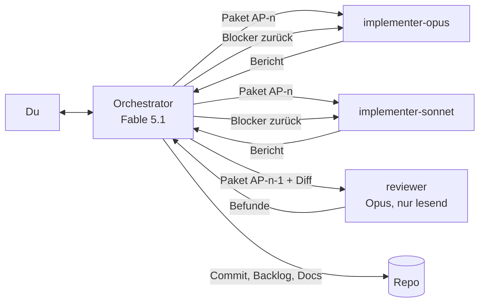
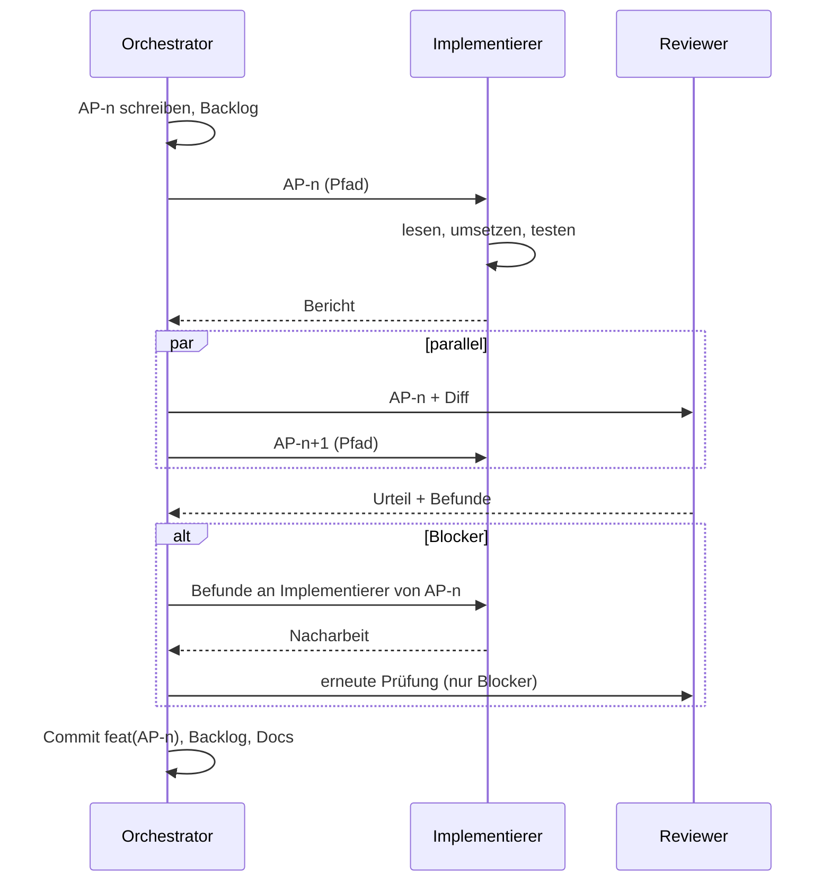

# agcowork – Entwicklungs-Workflow

> Wie wir mit einem Orchestrator und Subagenten entwickeln. Stand: 2026-11-07.
> Kurzfassung in [../CLAUDE.md](../CLAUDE.md), Agenten-Definitionen in `.claude/agents/`.

## 1. Rollen

### Orchestrator (Hauptsession, Fable 5.1)
- Hält das Gesamtbild: Planung, Architektur, Backlog, Entscheidungen.
- Schneidet Arbeitspakete so, dass ein Implementierer sie ohne Rückfrage umsetzen kann.
- Wählt pro Paket den Implementierer (siehe §3) und startet Reviews parallel.
- Entscheidet über Review-Befunde: zurück an den Implementierer, selbst beheben (nur Kleinigkeiten), bewusst zurückstellen (dann ins Backlog).
- Committet, pflegt Backlog und Dokumente. Spricht mit dir in Deutsch, knapp, mit Entscheidungsbedarf statt Statusprosa.
- Schreibt selbst keinen Feature-Code. Ausnahmen: Einzeiler, Doku, Konfiguration.

### implementer-opus (Subagent, Opus)
- Für Pakete, die Denken verlangen: erstes Auftreten eines Musters, Domänenmodell, Tenancy, Auth, Filter-DSL, MCP-Tools, Migrationsstrategie, alles Sicherheitsrelevante.
- Darf im Paket vorgesehene Entscheidungen treffen, meldet sie im Bericht.

### implementer-sonnet (Subagent, Sonnet)
- Für Pakete mit Referenzbeispiel: „Mach Collection-Endpunkte wie die Space-Endpunkte“, weitere Property-Editoren nach dem ersten, Tests nachziehen, Migrationen, Seed-Daten, Doku.
- Erfindet keine Muster. Fehlt das Referenzbeispiel, stoppt er und meldet.

### reviewer (Subagent, Opus, nur lesend)
- Prüft ein abgeschlossenes Paket gegen Paket und Architektur, Reihenfolge: Tenancy, Sicherheit, Korrektheit, Architekturtreue, Agent-Tauglichkeit, Tests, Code-Qualität.
- Urteil: Freigabe / Freigabe mit Hinweisen / Blockiert. Jeder Befund mit Datei, Zeile und Szenario.
- Ändert nichts. Läuft parallel zum nächsten Paket.

## 2. Arbeitspakete

Ein Arbeitspaket ist die einzige Übergabe zwischen Orchestrator und Implementierer. Es liegt
in `docs/pakete/AP-NNN-<kebab-titel>.md` nach [pakete/TEMPLATE.md](pakete/TEMPLATE.md) und enthält:

- Ziel in zwei Sätzen und den Bezug zur Roadmap-Phase.
- Implementierer (opus / sonnet) und Referenzbeispiel im Code, wenn sonnet.
- Scope: was rein gehört, was ausdrücklich nicht.
- Betroffene Dateien/Ordner (damit parallele Pakete disjunkt bleiben).
- Architektur-Bezug: welche Abschnitte aus `02-ARCHITEKTUR.md` gelten.
- Akzeptanzkriterien, nummeriert, testbar. Jedes wird zu mindestens einem Test.
- Tests, die mindestens entstehen müssen (inkl. Isolationstest, wenn Endpunkt/Tool).
- Offene Entscheidungen, die der Implementierer treffen darf.
- Status und Verlauf: angelegt, in Arbeit, im Review, Nacharbeit, abgeschlossen, mit Datum und Commit.

Größe: ein Paket ist in einer Implementierer-Sitzung fertig, grob ein halber bis ein Tag
menschlicher Arbeit. Größer → teilen. Kleiner als eine Stunde → in ein Nachbarpaket aufnehmen.

`docs/pakete/BACKLOG.md` listet alle Pakete mit Status, Implementierer, Abhängigkeiten.

## 3. Wahl des Implementierers

| Kriterium | opus | sonnet |
|---|---|---|
| Muster existiert im Code | nein, erstes Auftreten | ja, Paket nennt es |
| Betrifft Domänenmodell, Tenancy, Auth, Filter-DSL, MCP-Vertrag | ja | nein |
| Entscheidungen im Paket offen | ja | nein, alles festgelegt |
| Fehlerkosten (Sicherheit, Datenverlust, API-Vertrag) | hoch | gering |
| Typische Beispiele | Tenancy-Middleware, Query-Übersetzer, Revisionen, erster MCP-Tool-Satz, Table-View-Kern | zweiter bis n-ter Endpunkt, Property-Editoren, Migration, Seed, Tests, Doku, Styling |

Im Zweifel opus. Ein zu starkes Modell kostet Geld, ein zu schwaches kostet eine Review-Runde und Vertrauen.

## 4. Ablauf im Detail

1. **Schneiden.** Orchestrator schreibt das Paket und prüft: Kann ein Implementierer das ohne Rückfrage? Sind die betroffenen Dateien disjunkt zu laufenden Paketen?
2. **Übergeben.** Der Implementierer bekommt den Pfad des Pakets und höchstens drei Sätze Kontext. Nicht den Inhalt nacherzählen; das Paket ist die Quelle.
3. **Umsetzen.** Implementierer liest Paket, Konventionen, Referenzen; setzt um; schreibt Tests; baut und testet; berichtet.
4. **Review parallel.** Sobald der Bericht da ist, startet der Reviewer auf dieses Paket. Gleichzeitig beginnt das nächste Paket, sofern es disjunkte Dateien hat. Zwei Implementierer gleichzeitig nur auf disjunkten Dateien.
5. **Befunde.** Blocker gehen an denselben Implementierer-Agenten zurück (per Nachricht, sein Kontext bleibt erhalten). „Wichtig“ entscheidet der Orchestrator: jetzt oder Folgepaket. „Hinweis“ wandert ins Backlog oder wird verworfen.
6. **Abschluss.** Build grün, Tests grün, Reviewer nicht blockiert, Paketstatus „abgeschlossen“ mit Commit-Hash, Backlog aktualisiert. Hat sich eine Entscheidung geändert, wird sie in `01-PLANUNG.md` oder `02-ARCHITEKTUR.md` nachgezogen, nicht nur im Paket.
7. **Commit.** Ein Commit pro Paket, `feat|fix|chore|docs|test(AP-NNN): kurze englische Beschreibung`.

## 5. Parallelität und Isolation

- Standard: ein Implementierer und ein Reviewer gleichzeitig.
- Zwei Implementierer, wenn die Pakete disjunkte Dateien haben (z. B. Backend-Modul und Frontend-Feature). Dann bevorzugt in eigenen Git-Worktrees, der Orchestrator merged.
- Der Reviewer arbeitet nur lesend und kollidiert mit niemandem.
- Kein Agent committet außer dem Orchestrator.

## 6. Definition of Done (pro Paket)

- [ ] Alle Akzeptanzkriterien erfüllt und durch Tests belegt.
- [ ] `dotnet build`, `dotnet test`, `npm test` grün.
- [ ] Isolationstest vorhanden, wenn ein Endpunkt oder MCP-Tool neu ist.
- [ ] Review: Freigabe oder Freigabe mit Hinweisen; Blocker behoben.
- [ ] Beschreibungen für Agenten (Tools, Collections, Properties) vorhanden und verständlich.
- [ ] Paket, Backlog und ggf. Architektur-/Planungsdokument aktualisiert.
- [ ] Commit mit Paketnummer.

## 7. Wenn etwas schiefgeht

- **Implementierer meldet Unklarheit:** Orchestrator klärt im Paket nach, nicht im Chat mit dem Agenten; das Paket bleibt die Quelle.
- **Reviewer und Implementierer widersprechen sich:** Orchestrator entscheidet anhand der Architektur. Betrifft es eine Leitentscheidung, geht es an dich.
- **Paket wächst während der Arbeit:** Implementierer stoppt am Scope-Rand, meldet; Orchestrator schneidet ein Folgepaket.
- **Ein Muster erweist sich als falsch:** erst Architektur-Dokument ändern, dann Pakete.
