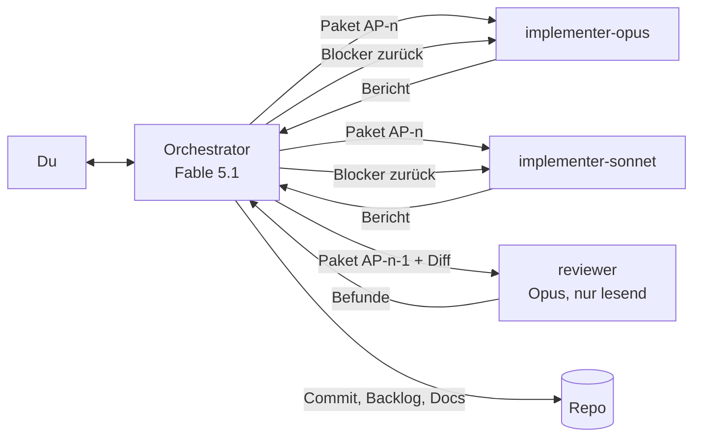
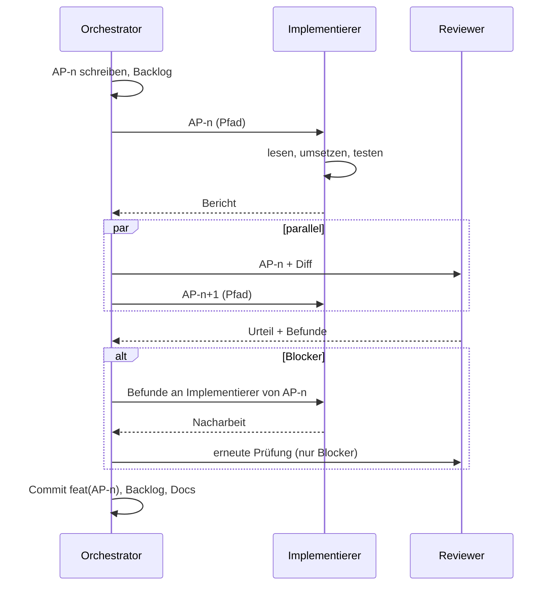

# agcowork – Entwicklungs-Workflow

> Wie wir mit einem Orchestrator und Subagenten entwickeln. Stand: 2026-11-07.
> Kurzfassung in [../CLAUDE.md](../CLAUDE.md), Agenten-Definitionen in `.claude/agents/`.

## 1. Rollen

### Orchestrator (Hauptsession, Fable 5.1)
- Hält das Gesamtbild: Planung, Architektur, Backlog, Entscheidungen.
- Schneidet Arbeitspakete so, dass ein Implementierer sie ohne Rückfrage umsetzen kann.
- Wählt pro Paket den Implementierer (siehe §3) und startet Reviews parallel.
- Entscheidet über Review-Befunde: zurück an den Implementierer, selbst beheben (nur Kleinigkeiten), bewusst zurückstellen (dann ins Backlog).
- Committet, pflegt Backlog und Dokumente. Spricht mit dir in Deutsch, knapp, mit Entscheidungsbedarf statt Statusprosa.
- Schreibt selbst keinen Feature-Code. Ausnahmen: Einzeiler, Doku, Konfiguration.

### implementer-opus (Subagent, Opus)
- Für Pakete, die Denken verlangen: erstes Auftreten eines Musters, Domänenmodell, Tenancy, Auth, Filter-DSL, MCP-Tools, Migrationsstrategie, alles Sicherheitsrelevante.
- Darf im Paket vorgesehene Entscheidungen treffen, meldet sie im Bericht.

### implementer-sonnet (Subagent, Sonnet)
- Für Pakete mit Referenzbeispiel: „Mach Collection-Endpunkte wie die Space-Endpunkte“, weitere Property-Editoren nach dem ersten, Tests nachziehen, Migrationen, Seed-Daten, Doku.
- Erfindet keine Muster. Fehlt das Referenzbeispiel, stoppt er und meldet.

### reviewer (Subagent, Opus, nur lesend)
- Prüft ein abgeschlossenes Paket gegen Paket und Architektur, Reihenfolge: Tenancy, Sicherheit, Korrektheit, Architekturtreue, Agent-Tauglichkeit, Tests, Code-Qualität.
- Urteil: Freigabe / Freigabe mit Hinweisen / Blockiert. Jeder Befund mit Datei, Zeile und Szenario.
- Ändert nichts. Läuft parallel zum nächsten Paket.

## 2. Arbeitspakete

Ein Arbeitspaket ist die einzige Übergabe zwischen Orchestrator und Implementierer. Es liegt
in `docs/pakete/AP-NNN-<kebab-titel>.md` nach [pakete/TEMPLATE.md](pakete/TEMPLATE.md) und enthält:

- Ziel in zwei Sätzen und den Bezug zur Roadmap-Phase.
- Implementierer (opus / sonnet) und Referenzbeispiel im Code, wenn sonnet.
- Scope: was rein gehört, was ausdrücklich nicht.
- Betroffene Dateien/Ordner (damit parallele Pakete disjunkt bleiben).
- Architektur-Bezug: welche Abschnitte aus `02-ARCHITEKTUR.md` gelten.
- Akzeptanzkriterien, nummeriert, testbar. Jedes wird zu mindestens einem Test.
- Tests, die mindestens entstehen müssen (inkl. Isolationstest, wenn Endpunkt/Tool).
- Offene Entscheidungen, die der Implementierer treffen darf.
- Status und Verlauf: angelegt, in Arbeit, im Review, Nacharbeit, abgeschlossen, mit Datum und Commit.

Größe: ein Paket ist in einer Implementierer-Sitzung fertig, grob ein halber bis ein Tag
menschlicher Arbeit. Größer → teilen. Kleiner als eine Stunde → in ein Nachbarpaket aufnehmen.

`docs/pakete/BACKLOG.md` listet alle Pakete mit Status, Implementierer, Abhängigkeiten.

## 3. Wahl des Implementierers

| Kriterium | opus | sonnet |
|---|---|---|
| Muster existiert im Code | nein, erstes Auftreten | ja, Paket nennt es |
| Betrifft Domänenmodell, Tenancy, Auth, Filter-DSL, MCP-Vertrag | ja | nein |
| Entscheidungen im Paket offen | ja | nein, alles festgelegt |
| Fehlerkosten (Sicherheit, Datenverlust, API-Vertrag) | hoch | gering |
| Typische Beispiele | Tenancy-Middleware, Query-Übersetzer, Revisionen, erster MCP-Tool-Satz, Table-View-Kern | zweiter bis n-ter Endpunkt, Property-Editoren, Migration, Seed, Tests, Doku, Styling |

Im Zweifel opus. Ein zu starkes Modell kostet Geld, ein zu schwaches kostet eine Review-Runde und Vertrauen.

## 4. Ablauf im Detail

1. **Schneiden.** Orchestrator schreibt das Paket und prüft: Kann ein Implementierer das ohne Rückfrage? Sind die betroffenen Dateien disjunkt zu laufenden Paketen?
2. **Übergeben.** Der Implementierer bekommt den Pfad des Pakets und höchstens drei Sätze Kontext. Nicht den Inhalt nacherzählen; das Paket ist die Quelle.
3. **Umsetzen.** Implementierer liest Paket, Konventionen, Referenzen; setzt um; schreibt Tests; baut und testet; berichtet.
4. **Review parallel.** Sobald der Bericht da ist, startet der Reviewer auf dieses Paket. Gleichzeitig beginnt das nächste Paket, sofern es disjunkte Dateien hat. Zwei Implementierer gleichzeitig nur auf disjunkten Dateien.
5. **Befunde.** Blocker gehen an denselben Implementierer-Agenten zurück (per Nachricht, sein Kontext bleibt erhalten). „Wichtig“ entscheidet der Orchestrator: jetzt oder Folgepaket. „Hinweis“ wandert ins Backlog oder wird verworfen.
6. **Abschluss.** Build grün, Tests grün, Reviewer nicht blockiert, Paketstatus „abgeschlossen“ mit Commit-Hash, Backlog aktualisiert. Hat sich eine Entscheidung geändert, wird sie in `01-PLANUNG.md` oder `02-ARCHITEKTUR.md` nachgezogen, nicht nur im Paket.
7. **Commit.** Ein Commit pro Paket, `feat|fix|chore|docs|test(AP-NNN): kurze englische Beschreibung`.

## 5. Parallelität und Isolation

- Standard: ein Implementierer und ein Reviewer gleichzeitig.
- Zwei Implementierer, wenn die Pakete disjunkte Dateien haben (z. B. Backend-Modul und Frontend-Feature). Dann bevorzugt in eigenen Git-Worktrees, der Orchestrator merged.
- Der Reviewer arbeitet nur lesend und kollidiert mit niemandem.
- Kein Agent committet außer dem Orchestrator.

## 6. Definition of Done (pro Paket)

- [ ] Alle Akzeptanzkriterien erfüllt und durch Tests belegt.
- [ ] `dotnet build`, `dotnet test`, `npm test` grün.
- [ ] Isolationstest vorhanden, wenn ein Endpunkt oder MCP-Tool neu ist.
- [ ] Review: Freigabe oder Freigabe mit Hinweisen; Blocker behoben.
- [ ] Beschreibungen für Agenten (Tools, Collections, Properties) vorhanden und verständlich.
- [ ] Paket, Backlog und ggf. Architektur-/Planungsdokument aktualisiert.
- [ ] Commit mit Paketnummer.

## 7. Gelernt aus Phase 0

- **Commit-Hash erst im Folge-Commit eintragen.** Wer den Hash per `--amend` in Backlog und Paket schreibt, ändert damit den Hash. Deshalb: Paket committen, Hash in Backlog/Paket eintragen, mit dem nächsten Commit mitnehmen.
- **Geteilte Dateien zwischen parallelen Paketen vorab benennen.** AP-003 hat AppHost.cs und launchSettings.json aus AP-001 verändert, bevor AP-001 committet war. Künftig: Ein abhängiges Paket startet erst, wenn das Vorgängerpaket committet ist, oder es bekommt die geteilten Dateien ausdrücklich zugewiesen und der Vorgänger wird vorher committet.
- **Nicht belegte Akzeptanzkriterien prüft der Orchestrator selbst**, bevor er committet (hier: Browser-Lauf unter Aspire). Der Reviewer startet keine Prozesse, die hängen können.
- **Nie zwei Pakete mit EF-Migration parallel.** Zwei Migrationen ändern denselben Model-Snapshot und kollidieren. Pro Welle höchstens ein Paket mit Migration; Pakete ohne Migration (Seeds, Vorlagen, Frontend) laufen daneben.
- **Hooks statt Verdrahtung.** Erweiterungspunkte (`ICollectionCreatedHook`, `ISchemaChangedHook`) früh einführen, damit Folgepakete sich registrieren statt bestehende Use-Cases zu ändern; spart Nacharbeit und Konflikte.
- **Sonnet hat für AP-003 gut funktioniert**, weil Referenzbeispiele und Kontext (Ports, Schlüsselbund) im Paket standen. Die Abweichung `.json` → `.js` hat er sauber begründet.

## 7a. Gelernt aus Phase 1

- **14 Pakete, 14 Reviews, 3× „Blockiert“** (AP-014 Overwrite-Body, AP-017 JSON-Editor, AP-009 NUL-Zeichen). Jeder Blocker war ein Datenverlust- oder 500-Pfad, den Tests nicht abdeckten; der Reviewer fand sie durch Szenario-Denken, nicht durch Testlauf. Review bleibt Pflicht, auch bei grünen Tests.
- **Wellen nach Abhängigkeiten, Migration als Taktgeber.** Pro Welle genau ein Backend-Paket mit Migration; Frontend und migrationsfreie Backend-Pakete parallel. So liefen bis zu drei Implementierer gleichzeitig ohne Konflikt.
- **Geteilte Dateien vorab benennen** (DependencyInjection.cs, UseCaseRegistrationTests.cs, generated/): Das Paket, das sie nicht braucht, bekommt ein Verbot; der andere Implementierer meldet Konflikte statt einzugreifen.
- **Sonnet funktioniert bei klaren Mustern** (AP-003, AP-008, AP-010, AP-014, AP-016, AP-017), braucht aber eine Nacharbeitsrunde mehr als Opus bei Randfällen (Datenverlust-Pfade, Nebenläufigkeit). Opus für alles, was Sperren, Parser oder Adapter-Verträge betrifft.
- **Entscheidungen sofort in die Architektur** (Sperr-Reihenfolge, Scopes, destruktive Schemaänderungen, Normalisierung, Bild-Platzhalter), sonst entscheiden Folgepakete anders.
- **Nutzungslimit:** Unterbrochene Agenten per Nachricht fortsetzen, nicht neu starten; der Arbeitsbaum bleibt erhalten.
- **CI auf Linux ist die Wahrheit, lokal ist macOS.** Die .NET-Uhr hat auf macOS Mikrosekunden-, auf Linux 100-ns-Auflösung; PostgreSQL speichert Mikrosekunden. Zeitstempel-Vergleiche vor/nach dem DB-Roundtrip fielen nur in der CI. Lösung: `MicrosecondTimeProvider` zentral, per `Replace` (ASP.NET Core registriert `TimeProvider.System` selbst), plus Host-Test. Nach jedem Push die CI abwarten, nicht nur lokale Tests.
- **Orchestrator-Rauchtest am Ende** jeder Phase im Browser, zusätzlich zu den Paket-Prüfungen; so fiel die fehlende Vorlagenauswahl in der UI auf.

## 7b. Gelernt aus Härtung und Phase-2-Welle 1 (AP-022 bis AP-028)

- **Sieben Pakete, fünf Blockaden im Review** (AP-024 Konzeptfehler im eigenen Paket, AP-025 zweimal, AP-026, AP-028). Keine davon war durch rote Tests sichtbar: Rennfenster, PostgreSQL-Grenzwerte mit Mehrbyte-Zeichen, Framework-Defaults, die von `IsDevelopment()` abhängen. Reviewer messen inzwischen gegen die laufende Compose-DB (nur SELECT/Temp-Tabellen); das hat sich bewährt.
- **Pakete, die der Orchestrator mit Lösungsvorschlag schreibt, können falsch sein.** AP-024 schlug „stabil, dann nach `seq`“ vor; der Implementierer hat den Verlustfall gefunden. Lösungsvorschläge im Paket als Vorschlag markieren und Abweichung mit Begründung ausdrücklich erlauben.
- **Nacharbeit erzeugt neue Fehler.** Die B1-Korrektur in AP-025 brachte N1. Nachprüfung durch denselben Reviewer (Kontext erhalten, per Nachricht) ist günstig und fängt das.
- **Tests laufen in Development.** Für Verhalten, das von der Umgebung abhängt, gehört ein Test mit `UseEnvironment("Production")` dazu (Muster `CookiePolicyTests`, `UnstorableTextEndpointsTests`).
- **Commits aus einem geteilten Arbeitsbaum:** Pfade explizit stagen; gemeinsame Dateien (`schema.d.ts`, Spec-Fixtures) bei Bedarf über `git update-index --cacheinfo` mit der paketeigenen Fassung. Danach den Commit in einem temporären `git worktree` (mit verlinktem `node_modules`) bauen und testen.
- **Rauchtest im Wegwerf-Stack** (`docker compose -p agcowork-smoke`, eigener Port, Zugangsdaten aus `.env.example`, danach `down -v`), damit die lokale Instanz unberührt bleibt.
- **Nutzungslimit:** unterbrochene Implementierer per Nachricht fortsetzen; beide Agenten haben ohne Verlust weitergemacht.

## 8. Wenn etwas schiefgeht

- **Implementierer meldet Unklarheit:** Orchestrator klärt im Paket nach, nicht im Chat mit dem Agenten; das Paket bleibt die Quelle.
- **Reviewer und Implementierer widersprechen sich:** Orchestrator entscheidet anhand der Architektur. Betrifft es eine Leitentscheidung, geht es an dich.
- **Paket wächst während der Arbeit:** Implementierer stoppt am Scope-Rand, meldet; Orchestrator schneidet ein Folgepaket.
- **Ein Muster erweist sich als falsch:** erst Architektur-Dokument ändern, dann Pakete.
